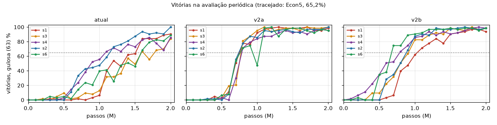
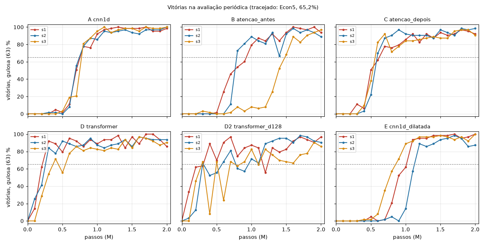

# LAB: PPO local (receita v2 e arquiteturas com atenção)

## ESTADO ATUAL (atualizado ao fim de cada execução)

**Comandos (PowerShell):**
- **Iniciar o monitor** (que liga a fila e a religa se ela morrer), numa janela própria, fora
  do Claude Code:
  `Start-Process powershell -ArgumentList '-NoExit','-Command','cd C:\Users\gului\Desktop\pvz-lab; python -m lab.monitor'`
  (ou, numa janela já aberta: `cd C:\Users\gului\Desktop\pvz-lab; python -m lab.monitor`).
- **Parar tudo:** `New-Item C:\Users\gului\Desktop\pvz-lab\lab\PARAR`. O arquivo de parada
  do lab é `C:\Users\gului\Desktop\pvz-lab\lab\PARAR` (nunca o `rl/PARAR` oficial). A
  execução em curso grava o checkpoint no fim da atualização em andamento (~1 s) e sai, a
  fila não começa a próxima e o monitor sai sem religar.
- **Retomar:** `Remove-Item C:\Users\gului\Desktop\pvz-lab\lab\PARAR` e iniciar o monitor de
  novo (comando acima). As execuções terminadas são puladas, e a interrompida continua do
  `ckpt.pt` (retomada exata, testada).
- **Ver o estado:** `python -m lab.fila --status`; quedas e religadas em `lab\monitor.log`;
  saída da fila em `lab\fila_saida.log`; tabelas: `python -m lab.relatorio` (reescreve a seção
  "RESULTADOS (gerado)" no fim deste arquivo).

**Situação:**
- **Já rodou:** Fase 0 (código, testes, medições; ver "Fase 0: o que foi feito"); teto e
  sanidade dos 6 braços (16/10, 16h20–16h52; todos aprovados, ≥ 98%; ver "Resultados:
  sanidade e teto").
- **Queda às 17h00:** a fila foi morta pelo Claude Code por falta de memória no sistema (não
  foi erro do código). A `lab-f1-atual-s1` estava no passo ~1,19M, sem checkpoint, e
  **recomeça do zero**. A saída dela até a queda ficou em
  `rl/logs/lab-f1-atual-s1.morta-17h.log`; a pasta `rl/logs/lab-f1-atual-s1/` (registro e
  avaliações parciais) foi apagada antes do recomeço.
- **Proteções novas (16/10, 18h–19h; ver "Checkpoint automático, monitor e memória"):**
  checkpoint automático a cada 250k passos, monitor que religa a fila e RAM registrada por
  execução. Testadas.
- **Fase 1 terminada (17/10, 04h47):** 15 execuções, sem quedas. As duas variantes foram aceitas, e o desempate pelo desvio escolheu a **v2a** (média 96,2% ± 1,1, contra 86,9% ± 4,4 da atual e 94,6% ± 1,5 da v2b). A previsão do Claude foi confirmada. Ver "Resultados: Fase 1".
- **Fase 2 terminada (17/10, 10h10):** 15 execuções, sem quedas. **Nenhum braço venceu a cnn1d** (96,6% ± 1,2): B 93,0 e C 92,1 perderam, D 89,4 e D2 86,3 perderam, a dilatada (E) 94,4 empatou. D2 × D e B × C deram empate. Os transformers cruzam o Econ5 bem mais cedo (300–400k contra 800k), mas terminam oscilando. Ver "Resultados: Fase 2" (vereditos, previsões e riscos de leitura).
- **Avaliação extra e Parte 0 feitas (17/10, 11h20–12h25):** ver "Resultados: avaliação extra e Parte 0". Os baselines do estresse foram corrigidos para k = 20.
- **Parte 1 terminada (17/10, 12h29–15h16; avaliação extra às 15h35):** rodaram os dois ramos do D, sem quedas. **D v2b** 94,7% ± 4,5: empata com o D da Fase 2 (+5,2, 2·s_c 6,8) e com a cnn1d no final (−1,9), mas perde para a cnn1d no estresse. **D coef_ent 0,01** 79,8% ± 2,1: perdeu para todos. Ver "Resultados: Parte 1".
- **Nada roda; a GPU está livre.**
- Subir algo para o projeto oficial é decisão do Gustavo (fora desta tarefa).
- **Smoke test fora do protocolo:** antes do teto oficial, um teste de 1.000 atualizações
  do D2 com semente 99 (só para ver se rodava) imprimiu uma nota (72,2%; longe 54,9% em 82
  pares). A pasta foi apagada; não conta como resultado. A definição de longe/perto já
  estava escrita acima.

---

## Para que serve

Laboratório **local**, paralelo ao trabalho oficial, só neste computador
(RTX 3050 Laptop, CUDA, torch 2.11.0+cu128). Pasta `C:\Users\gului\Desktop\pvz-lab`, uma
cópia da `C:\Users\gului\Desktop\pvz-ppo` (a worktree da branch `ppo`) feita em 16/10/2026,
sem o `.git`, sem os `ckpt/` do DQN (1,4 GB de replay), sem `__pycache__`.
Se algo der certo, o Gustavo decide subir para o projeto oficial; isso não faz parte do lab.

Objetivos: (1) uma receita de PPO corrigida ("baseline v2") que reduza a variância entre
sementes; (2) comparar arquiteturas com atenção contra a cnn1d no PPO, todas com a
receita escolhida.

## Regras

- **Sem git:** nada de commit, branch, worktree, push ou pull. A cópia não tem `.git`. Nada
  aqui depende do git (o `rl/ppo.py` já passava `rascunho=True` para o proxy).
- **Não alterar a pasta oficial** (`PythonProject1`, `pvz-ppo`, `pvz-diag`).
- Uma execução por vez na GPU. Nada de DQN. Nada da pasta oficial rodando ao mesmo tempo.
- Arquivo de parada próprio: `lab\PARAR` (nunca o `rl/PARAR` oficial, que é global).
- **Nunca as fases de teste.** Avaliação oficial: FASES_TREINO × sementes 300–319 (420
  partidas), gulosa; treino nas sementes 1000–9999 (as de sempre do `rl/ppo.py`).
- A receita atual da cnn1d no PPO continua idêntica (teste
  `test_receita_atual_reproduz_a_ppo_fases_s0`). A política lê das redes: logits = A (225
  plantios + esperar, antes da subtração da média do dueling), crítico = V, inválidas −1e9
  pela máscara dos canais 20–24.
- As previsões e regras abaixo **não se editam** depois de escritas; os resultados entram
  em seções novas.
- Se algo falhar: parar nesse item, descrever o que aconteceu e seguir com o que não
  depende dele, sem contornar o problema.

## Os braços (fluxo de formas; B = lote)

Todos: entrada v2 `(B, 25, 5, 9)` (20 canais da seção 2.3 com sol/200, mais a máscara de
plantio nos canais 20–24). Saída `partes(x)` = (mapa A `(B, 5, 5, 9)` na ordem
(planta, faixa, coluna) de `codificar_acao`, A(esperar) `(B, 1)`, V `(B, 1)`). Política:
`logits = cat(mapa.flatten → (B, 225), A(esperar)) → (B, 226)`, inválidas = −1e9; crítico = V.
Código: `desafio3/modelo.py` (registry `ARQUITETURAS`), política em `rl/ppo.py`
(`Politica` para a cnn1d, intacta; `PoliticaArq` para os novos).

- **A. cnn1d** (referência, intacta, 88.775 parâmetros):
  `x (B,25,5,9) → conv1 3×3 25→64 → ReLU → conv2 3×3 → ReLU → conv3 3×3 → ReLU → h (B,64,5,9)`;
  `mapa = conv 1×1 64→5 (h) → (B,5,5,9)`; `g = média(h) (B,64)`; `A(esperar) = Linear(g)`,
  `V = Linear(g)`. Campo de visão de cada célula: ±3 colunas, ±3 faixas.
- **B. atencao_antes** (130.567): `x → tokens (B,45,25) → Linear 25→64 → t (B,45,64)`;
  `t ← t + Wo·MHA(LN(t + pos))` (4 cabeças de 16, pre-LN, residual, sem MLP; `pos` =
  embedding de faixa + embedding de coluna, aprendidos, `(45,64)`) `→ grade (B,64,5,9) →`
  o tronco da cnn1d (conv1 agora 64→64, conv2, conv3) `→` as cabeças da cnn1d.
- **C. atencao_depois** (106.439): o tronco da cnn1d `→ h (B,64,5,9) → tokens (B,45,64)`;
  `h ← h + Wo·MHA(LN(h + pos))` com **Wo = 0 e viés 0 na inicialização** (a posição entra
  só na entrada do ramo, não no resíduo, então a camada começa como identidade e a rede
  começa igual à cnn1d) `→ grade → ` as cabeças da cnn1d.
- **D. transformer** (103.175): `x → (B,45,25) → Linear 25→64 + pos → (B,45,64)`;
  `cat(CLS) → (B,46,64)` → 2 blocos pre-LN (MHA 4×16 + MLP 64→256→64 com GELU), sem
  máscara causal → LN `→ células (B,45,64)`, `CLS (B,64)`; plantios = `Linear 64→5` em cada
  célula `(B,45,5) → (B,5,5,9)`; A(esperar) e V = `Linear 64→1` no CLS. A única máscara é a
  das ações inválidas na saída.
- **D2. transformer_d128** (402.951 = 3,9× o D): igual ao D com d = 128, 4 cabeças de 32,
  MLP 128→512→128. Pergunta de capacidade; comparação principal D2 × D.
- **E. cnn1d_dilatada** (88.775, os mesmos parâmetros e formas da cnn1d): dilatação só nas
  colunas, `(1,1)`, `(1,5)`, `(1,2)` (padding igual). Toda célula alcança as 9 colunas da
  própria faixa (testado por caminho e pelo gradiente). Separa "atenção" de "enxergar longe".
  *Nota:* a primeira escolha, (1, 2, 5), alcança −8..8 em tese, mas com padding de zeros os
  caminhos que passam fora do tabuleiro morrem, e a célula 4 não via as colunas 0 e 8 (o
  teste pegou). Das combinações com máximo ≤ 5 que cobrem tudo, (1, 5, 2) é a única com a
  primeira camada local (d = 1), como na cnn1d.

## Protocolo

### Fase 0: preparativos
- Testes (`tests/test_lab.py`): formas e ordem da saída; E com os mesmos parâmetros da
  cnn1d e cobertura completa das colunas; C na inicialização = cnn1d com os mesmos pesos;
  B, C, D, D2 e E sensíveis a uma célula a 8 colunas de distância, e a cnn1d não (no C, o
  teste dá um valor qualquer ao Wo, que começa em 0); D e D2 invariantes à ordem dos tokens
  (permutar tokens + embeddings dá a mesma saída, permutada); reprodução das 4 primeiras
  atualizações da `ppo-fases-s0` (CUDA) bit a bit; parada e retomada exatas (cnn1d e D).
- Medir parâmetros, passos/s no PPO e estimativa para 2M (`lab/medir.py`, `lab/medidas.json`).
- **Sanidade** de cada braço: PPO na fase "calmo", dificuldade 0,5, ~300k passos (301.056),
  avaliação final de 200 partidas (sementes 300–499; periódica a cada 20k com 300–399),
  semente 0, receita atual: a mesma config da `ppo-sanidade` (cnn1d, 98%). A cnn1d também
  roda (confere a máquina). **Abaixo de 80%: o braço não vai para a Fase 2**; registrar
  entropia, perda_v e kl e seguir com os outros. O D2 roda a sanidade mesmo que o D falhe.
  Ids `lab-san-<braço>`.
- **Teto** (só registro, sem veredito): `python -m lab.teto --arquitetura <braço>`, 1
  semente (0) por braço, a mesma regressão do `rl/diag/teto.py`, nota na prova de
  avaliação, separada em pares "longe" e "perto" (definição abaixo). Ids `lab-teto-<braço>-s0`
  em `rl/diag/logs/`. As provas foram regeneradas na cópia (`python -m rl.diag.prova`; os
  arrays não estavam no git).

#### Definição de "longe" e "perto" (escrita antes de ver qualquer nota)
Com a observação v1 guardada na prova:
- zumbi na célula (f, c) ⇔ canais 7 + 8 + 9 > 0 em (f, c);
- para um plantio candidato em (f, c): dist = menor |c' − c| entre as células (f, c') da
  mesma faixa com zumbi; faixa sem zumbi → dist indefinida. "Esperar" não tem dist;
- candidata **longe** ⇔ dist > 3 (fora do campo de visão de ±3 colunas da cnn1d);
  **perto** ⇔ dist ≤ 3;
- par **longe** ⇔ pelo menos uma das duas candidatas é longe e nenhuma é perto;
  par **perto** ⇔ qualquer outro par. Os pares em que nenhuma candidata tem zumbi na faixa
  (`sem_zumbi`) entram em "perto" e também são contados à parte.
- É uma aproximação: "a informação que decide o par" é tomada como o zumbi mais próximo na
  faixa do plantio. Os pares claros são os mesmos da `prova.nota` (|ΔQ̂| > 0,02 e > 2·EP).

### Fase 1: baseline v2 (cnn1d, 2M passos)
Painel de sementes: 1, 3, 4 (falharam: 17%, 4%, 12% a 2M) e 2, 6 (deram certo: 94%, 89%).
Esses números são das execuções `ppo-fases-s*` da branch `ppo`, que rodaram em **CPU**
(máquina sem CUDA). Por isso a referência é **refeita aqui em CUDA**: 5 execuções da
receita atual (`lab-f1-atual-s<semente>`). (A semente 0 deu 82% em CUDA e 61% em CPU.)

Variantes, cada uma no painel inteiro:
- **v2a** (`lab-f1-v2a-s*`): coeficiente de entropia 0,01 → 0,03.
- **v2b** (`lab-f1-v2b-s*`): v2a + η decaindo linearmente até 0 ao longo dos 2M
  (receita `atual_linear`: fator 1 − t/T, T = passos do otimizador no orçamento; as 16
  últimas atualizações, da coleta que passa de 2M, ficam com η = 0).

Tudo o mais igual à receita atual: Adam 2,5e-4 (ε = 1e-5), 16 partidas × 128 passos, 4
épocas, minilote 512, clip 0,2, GAE λ = 0,95, γ = 0,994, k = 20, coef. V 0,5, norma 0,5.
Avaliação periódica gulosa a cada 100k (63 partidas, sementes 300–302; não consome os
geradores do treino, então não muda a trajetória) e final com 420.
Ordem da fila: por semente (1, 3, 4, 2, 6), e em cada uma atual → v2a → v2b.

**Previsão (Claude):** a v2a mantém a entropia das sementes 1, 3 e 4 acima de 0,4 até 500k,
e pelo menos 2 delas passam de 50%.

**Regra:** uma variante é aceita se ≥ 2 das 3 sementes ruins passam de 50% e nenhuma das
boas cai mais de 10 pontos. Se as duas forem aceitas, fica a de menor desvio nas 5 sementes;
empate → v2a (mais simples, e o η constante permite estender o treino). Se nenhuma for
aceita, a Fase 2 usa a receita atual, e o LAB.md registra isso como o problema principal.

Leitura operacional (fixada antes de rodar): "sementes ruins" = 1, 3, 4; "passam de 50%" =
vitórias finais (420 partidas) > 50%; "cai mais de 10 pontos" = final da variante < final da
receita atual **refeita aqui em CUDA** na mesma semente − 10 pontos. "Ruins" e "boas" são os
rótulos da CPU; se em CUDA a referência mudar de lado, a regra continua com os mesmos
rótulos, e isso é registrado. "Menor desvio" = desvio-padrão amostral das 5 finais;
"empate" = diferença de desvio < 1 ponto.

### Fase 2: arquiteturas (receita escolhida na Fase 1, 2M passos)
Braços aprovados na sanidade × sementes 1, 2 e 3, as mesmas para todos (a cnn1d reaproveita
as execuções da Fase 1). Ordem da fila: uma semente de cada braço (B, C, D, E, e o D2 por
último), depois a próxima semente, para os parciais já serem comparáveis.
Ids `lab-f2-<braço>-s<semente>`.

**Previsões:** (Gustavo) a atenção antes ganha da atenção depois, e as arquiteturas com
atenção podem reduzir a variância entre sementes. (Claude) a atenção depois ganha ou empata
com a atenção antes; se o gargalo for o campo de visão, a dilatada também ganha da cnn1d;
o D2 empata com o D (a capacidade não é o gargalo: a cnn1d, com 89 mil parâmetros, já
chega a 94% em algumas sementes).

**Regra para dizer "venceu":** |Δ média| > 2·s_c (s_c = √((s_A² + s_B²)/2)) nas mesmas
sementes; cada braço contra a cnn1d, e o D2 também contra o D. Reportar à parte a
velocidade e a variância, mesmo sem veredito.

### Sementes usadas
- Treino do PPO: 1000–9999 (sorteadas pelo `rng` da semente de treino).
- Avaliação: periódica 300–302 × 21 fases (63); final 300–319 × 21 (420). Sanidade:
  periódica 300–399, final 300–499 na fase "calmo".
- Provas do teto: avaliação FASES_TREINO × 600–629, treino × 700–799 (as do `rl/diag`).
- Sementes de treino do PPO (as "sementes" dos painéis): 0 (sanidade e testes), 1, 2, 3, 4, 6.
- Nenhuma fase de teste e nenhuma semente ≥ 10000.

### Onde está cada log
- PPO: `rl/logs/<id>/` (config.json, registro.csv, avaliacoes.csv, resultado.json,
  modelo.pt, melhor.pt, ckpt.pt) e a saída em `rl/logs/<id>.log`. Fila: `lab/fila.json`.
- Teto: `rl/diag/logs/lab-teto-<braço>-s0/`. Medidas: `lab/medidas.json`.
- Testes: `python -m pytest tests` (149 passam); parada da fila: `lab/teste_parada.txt`.

---

## Fase 0: o que foi feito (16/10/2026)

### Achados antes de rodar
1. **A receita "atual" da branch `ppo` mudou sem querer.** Todas as execuções de
   referência (`ppo-fases-s0` em CUDA, as sementes 0-cpu a 7 em CPU, a `ppo-sanidade`)
   rodaram antes do mecanismo `RECEITAS`, com Adam ε = 1e-5. Depois do `RECEITAS`, o
   `rl/ppo.py` cria o Adam pelo `desafio3/treino.py`, que usa o ε padrão (1e-8). Com o código
   da branch, o início da `ppo-fases-s0` **não se reproduz** (já na 1ª atualização: entropia
   0,815774 × 0,815845); com ε = 1e-5, reproduz **bit a bit** (as 4 primeiras atualizações:
   episódios, entropia, kl, fração cortada, perda_v e perda_pi idênticos). No lab, as
   receitas `atual*` voltam a usar ε = 1e-5 (`EPS_ADAM_ATUAL` em `rl/ppo.py`). As receitas
   `vencedora`, `rmsprop` e `muon` não mudaram. **Para a branch oficial:** as execuções
   `ppo-rec-*` e qualquer "atual" rodada depois do `RECEITAS` usam ε = 1e-8.
2. **Retomada do PPO em CUDA quebrava** (`TypeError: RNG state must be a torch.ByteTensor`):
   o `map_location` leva o estado do gerador para a GPU. Na branch, as retomadas foram em
   CPU. Corrigido na cópia (`.cpu()` no estado). Além disso, a retomada agora é **exata**:
   o checkpoint guarda as 16 partidas em voo (os `Ambiente`, em pickle), os geradores
   globais do torch (CPU e CUDA) e o tempo decorrido. Antes, as partidas em voo recomeçavam.
3. O PPO em CUDA é determinístico de uma execução para outra nesta máquina (sem
   `use_deterministic_algorithms`): duas execuções iguais deram os mesmos números.

### Mudanças na cópia
- `desafio3/modelo.py`: os braços B, C, D, D2, E (registry `ARQUITETURAS`).
- `rl/ppo.py`: `Config.arquitetura` (padrão cnn1d → `Politica` intacta), `PoliticaArq`,
  `Config.arquivo_parar`, checkpoint exato, ε = 1e-5 nas receitas `atual*`, receita
  `atual_linear` (v2b). `--arquitetura`, `--arquivo-parar`.
- `lab/`: `fila.py`, `teste_parada.py`, `medir.py`, `teto.py`, `relatorio.py`.
- `tests/test_lab.py` (novo) e `tests/test_arquiteturas.py` (o teste do registry aceita os
  braços novos depois dos quatro de sempre).

### Medidas (lab/medidas.json; começo do treino, FASES_TREINO, receita atual)
| braço | parâmetros | passos/s | razão (cnn1d ÷ braço) | estimativa 2M |
|---|---|---|---|---|
| A cnn1d | 88.775 | 1.858 | 1,00 | ~20 min (a preencher com o tempo real) |
| B atencao_antes | 130.567 | 1.421 | 1,31 | ~26 min |
| C atencao_depois | 106.439 | 1.530 | 1,21 | ~24 min |
| D transformer | 103.175 | 1.228 | 1,51 | ~30 min |
| D2 transformer_d128 | 402.951 | 1.087 | 1,71 | ~34 min |
| E cnn1d_dilatada | 88.775 | 1.830 | 1,02 | ~20 min |

A estimativa usa ~20 min para a cnn1d (a `ppo-fases-s0` levou 17,2 min aqui, a 1.940
passos/s) vezes a razão; é refeita com o tempo real das execuções.

### Teste de parada da fila (lab/teste_parada.txt)
A fila com duas execuções parou quando `lab\PARAR` foi criado (no passo 22.528, com
checkpoint; a segunda não começou). Apagado o arquivo e chamada a fila de novo, ela retomou
e terminou as duas; a interrompida ficou idêntica à referência sem parada (registro.csv,
avaliação final e pesos).

---

## Resultados (seções novas abaixo; nada acima se edita)

### Resultados: sanidade e teto (16/10/2026, 16h20–16h52)

**Sanidade:** os 6 braços passam do limiar de 80% e vão para a Fase 2. cnn1d 98,0% (o mesmo
número da `ppo-sanidade` oficial, o que confere a máquina), B 100%, C 100%, D 100%, D2 100%,
E 99,5% (200 partidas). A fase é fácil demais para separar os braços: é só um filtro.
O D e o D2 passaram, então a pergunta "o D2 passa e o D não" não se aplica.

**Teto** (1 semente, só registro): a cnn1d dá 73,3%, a mesma nota do `teto-cnn1d-s0` oficial
(prova regenerada idêntica; mesmo treino). Todos ficam entre 69,0% (D2) e 73,3% (cnn1d) no
total. Nos pares "longe" (só 82; IC 95% de ±11 pontos por nota): B 67,1%, D2 65,9%, cnn1d e E
59,8%, D 54,9%, C 53,7%. Nenhuma diferença nos pares longe sai do ruído. A divisão deixou poucos
pares "longe" (82 de 1.255): a maior parte dos pares claros não tem zumbi na faixa (831) ou
tem zumbi a ≤ 3 colunas (342). O D2 parou cedo (atualização 1000) e tem a pior nota no "perto",
o que é compatível com um ajuste mais ruidoso com 4× os parâmetros e os mesmos 1.800 estados
de treino.

### Checkpoint automático, monitor e memória (16/10/2026, 18h–19h)

Feito depois da queda das 17h, antes de religar a fila.

**Checkpoint automático.**
- O que muda: `Config.ckpt_cada = 250_000` em toda execução. O `ckpt.pt` é gravado no
  primeiro fim de atualização depois de cada múltiplo de 250k, depois da avaliação do mesmo
  passo, se houver. Ele continua sendo gravado também no PARAR e no fim.
- O que o checkpoint guarda: pesos, otimizador, agenda de η, rng do numpy, gerador do torch,
  estados globais do torch (CPU e CUDA), as 16 partidas em andamento, registro, avaliações,
  melhor vitória e tempo decorrido.
- A gravação é atômica (`ckpt.tmp` e depois `os.replace`), para uma morte no meio da gravação
  não estragar o checkpoint anterior. Ao lado vai `ckpt.json` com o passo.
- A fila já chama cada execução com `--continuar`: se existir checkpoint, ela retoma dele.
- Gravar o checkpoint não mexe na trajetória.
- **Teste** (`python -m lab.teste_ckpt`, saída em `lab/teste_ckpt.txt`):
  - Comparação: 100k passos direto × a mesma execução morta à força (taskkill /F) logo depois
    do checkpoint de 51.200 e retomada até 100k.
  - Configuração: receita v2b, para cobrir também a agenda de η.
  - Resultado: **igual bit a bit** na CUDA. O `registro.csv` (49 atualizações, sem a coluna
    passos/s), o `avaliacoes.csv`, as vitórias finais e os pesos são idênticos.

**Monitor** (`lab/monitor.py`; comandos no topo).
- O que ele faz:
  - Liga a fila. Se ela sair sem terminar, registra a queda, espera 30 s e religa.
  - Não religa com o `lab\PARAR` presente nem com a fila terminada: nesses casos, sai.
  - Se só a fila morrer e o treino dela continuar vivo (órfão), espera o treino acabar antes
    de religar. Assim nunca há dois treinos na GPU.
  - Se a mesma execução cair 3 vezes seguidas sem o checkpoint avançar, ela é marcada como
    falha. O fim do log vai para `lab/fila_falhas.json` e aparece na tabela da fila abaixo, e
    a fila segue para a próxima.
- Um detalhe da regra das 3 falhas: uma queda em que o checkpoint avançou zera a contagem.
  Uma morte por falta de memória no passo 1,2M não é o mesmo que um erro que se repete no
  mesmo lugar. Sem isso, três quedas por memória marcariam como falha uma execução boa.
- Cada evento (início, queda, órfão, religada, falhou, parado, completa) vai para
  `lab/monitor.log` com horário, execução, passo e motivo.
- **Teste** (`python -m lab.teste_monitor`, saída em `lab/teste_monitor.txt`): fila de teste
  com 4 execuções curtas. Todos os itens passaram:
  1. Treino morto à mão no passo 20.480: o monitor registrou a queda, religou e a execução
     retomou do 20.480 e terminou.
  2. Execução com arquitetura inexistente: 3 quedas, marcada como falha com o fim do log
     (`KeyError: 'nao_existe'`) e pulada.
  3. Só a fila morta à mão: o treino órfão continuou e o monitor esperou ele acabar, sem
     começar outro.
  4. `lab\PARAR` criado no meio de uma execução: checkpoint no 22.528, o monitor saiu e nada
     rodou nos 10 s seguintes. Com o arquivo apagado, o monitor de novo retomou do 22.528 e
     saiu com a fila completa.
- Um bug foi encontrado e corrigido no primeiro teste: quando uma execução terminava e a
  próxima caía, a queda era atribuída à anterior. Agora ela vem do treino em curso
  (`lab/filho.json`).

**Memória.**
- O que se registra:
  - Cada execução grava no `resultado.json` a RAM do próprio processo (working set ≈ RSS) no
    começo, no fim e no pico.
  - A fila anota a RAM dela e a do treino no começo e no fim de cada execução, em
    `lab/memoria.csv`.
  - O relatório mostra isso numa coluna das tabelas e na seção "Memória", com uma checagem
    automática de crescimento.
  - O log de cada execução mostra a RAM a cada 10 atualizações.
- Medida antes de religar (cnn1d, FASES_TREINO, 400k passos): a RAM do treino sobe para
  ~1,6 GB no começo, que é a inicialização do torch com CUDA, e **fica parada** (1.620 → 1.624 MB
  entre 40k e 350k). Não há sinal de vazamento dentro de uma execução. Entre execuções, a
  checagem fica na seção gerada.
- A queda das 17h foi falta de memória na máquina inteira (15,6 GB). O lab usa ~1,6 GB e não
  cresce.

### Resultados: Fase 1 (16/10, 19h05, até 17/10, 04h47; pausa de 20h53 a 01h22)

As 15 execuções terminaram sem nenhuma queda. Vitórias finais (420 partidas, gulosa,
FASES_TREINO × 300–319):

| receita | s1 | s3 | s4 | s2 | s6 | média | dp | ruins > 50% | boas: maior queda vs atual |
|---|---|---|---|---|---|---|---|---|---|
| atual | 86,9 | 84,0 | 83,8 | 94,5 | 85,2 | 86,9 | 4,43 | 3/3 | — |
| v2a (coef_ent 0,03) | 97,4 | 97,1 | 95,0 | 95,2 | 96,4 | **96,2** | **1,08** | 3/3 | nenhuma (+0,7 na s2, +11,2 na s6) |
| v2b (v2a + η linear até 0) | 93,8 | 93,3 | 93,6 | 95,7 | 96,7 | 94,6 | 1,48 | 3/3 | nenhuma |

**Decisão pela regra escrita antes:**
- As duas variantes são aceitas: as 3 sementes ruins passam de 50% e nenhuma semente boa cai.
- O desempate é pelo menor desvio-padrão: v2a 1,08 contra v2b 1,48.
- **Receita da Fase 2: v2a** (gravada em `lab/receita_f2.txt`).

**Previsão do Claude: confirmada.** A previsão dizia que a v2a mantém a entropia das sementes
1, 3 e 4 acima de 0,4 até 500k e que pelo menos 2 delas passam de 50%:

| receita | entropia mín. até 500k, s1 | s3 | s4 |
|---|---|---|---|
| atual | 0,431 | **0,166** | 0,475 |
| v2a | 0,550 | 0,779 | 0,512 |
| v2b | 0,645 | 0,777 | 0,741 |

As 3 sementes ruins passam de 50% na v2a (97,4, 97,1 e 95,0).

**Leitura (sem mudar a regra):**
- **O critério "sementes ruins acima de 50%" não separou nada: a receita atual também passa
  nas três**, com 84–87%. As sementes 1, 3 e 4 eram "ruins" nas execuções originais, em CPU
  e com orçamento menor. Na CUDA, com 2M passos, elas só destravam tarde: a atual-s1 ficou em
  ~0% até 900k e foi a 84% em 1,6M. Quem decidiu de fato foi o desempate pelo desvio.
- A v2a ganha da receita atual com folga pelo critério da Fase 2. Isso é só informativo: o
  critério da Fase 1 é o de cima.
  - Δ = +9,3 pontos;
  - s_c = √((4,43² + 1,08²)/2) = 3,2, então 2·s_c = 6,4.
- O ganho vem de destravar mais cedo, não de um teto maior.
  - Com a v2a, a s1 cruza o Econ5 (65,2%) por volta de 800k; com a atual, só em 1,6M.
  - Na s2, que destrava cedo nas três receitas, as três empatam (94,5 a 95,7).
- A v2b destrava ainda mais cedo em algumas sementes. Na s4 e na s6, ela já tem 35% em 500k,
  contra 3–6% das outras. Mas termina um pouco abaixo da v2a nas sementes ruins (93–94 contra
  95–97). Isso é compatível com o η indo a zero, que congela a política antes de ela refinar.
  A diferença é pequena (5 sementes), e o caso não está provado.
- A semente 6 era "boa" nas execuções originais, mas aqui foi a pior da receita atual
  (85,2%). As categorias boa/ruim vieram de outro dispositivo e de outro orçamento, então não
  se transferem.
- **O tempo real por execução foi de 18–25 min** (a estimativa era de 13–15). As partidas
  ficam mais longas quando a rede começa a vencer, e a velocidade cai de ~2.400 para ~1.500
  passos/s.

### Resultados: Fase 2 (17/10, 04h49 às 10h10)

As 15 execuções terminaram sem nenhuma queda. A receita foi a v2a, com 2M passos. A cnn1d são
as `lab-f1-v2a-s1/s2/s3`. A tabela completa (pico, cruzamento do Econ5, entropia, parâmetros,
velocidade, tempo e RAM) e a figura `lab/figuras/curvas_f2.png` estão na seção gerada abaixo.

| braço | s1 | s2 | s3 | média | dp | Δ vs cnn1d | 2·s_c | veredito | cruza o Econ5 | passos/s | min |
|---|---|---|---|---|---|---|---|---|---|---|---|
| A cnn1d | 97,4 | 95,2 | 97,1 | **96,6** | 1,2 | — | — | referência | 0,8M | 1.636 | 20,8 |
| B atenção antes | 93,6 | 92,9 | 92,4 | 93,0 | 0,6 | −3,7 | 1,9 | **perdeu** | 0,8–1,5M | 1.766 | 18,9 |
| C atenção depois | 94,3 | 92,1 | 90,0 | 92,1 | 2,1 | −4,4 | 3,5 | **perdeu** | 0,6–0,7M | 1.730 | 19,3 |
| D transformer | 88,8 | 91,4 | 88,1 | 89,4 | 1,8 | −7,1 | 3,0 | **perdeu** | **0,3–0,4M** | 1.374 | 24,3 |
| D2 transformer d128 | 89,0 | 89,5 | 80,5 | 86,3 | 5,1 | −10,2 | 7,4 | **perdeu** | **0,3–0,4M** | 1.143 | 29,2 |
| E cnn1d dilatada | 95,2 | 90,7 | 97,4 | 94,4 | 3,4 | −2,1 | 5,1 | empate | 0,9–1,2M | **2.233** | **15,0** |

Comparações extras pela mesma regra:
- **D2 × D:** Δ = −3,1, 2·s_c = 7,6, **empate**.
- **B × C:** Δ = +0,8, 2·s_c = 3,2, **empate**.

**Nenhum braço novo venceu a cnn1d.** Quatro perderam pela regra (B, C, D e D2) e a dilatada
empatou.

**Previsões (escritas antes de rodar):**
- *(Gustavo) A atenção antes ganha da atenção depois:* empate pela regra. A direção favorece a
  atenção antes (93,0 contra 92,1), mas a diferença está dentro do ruído.
- *(Gustavo) A atenção pode reduzir a variância:* inconclusivo.
  - A atenção antes teve o menor desvio do painel (0,6, contra 1,2 da cnn1d); a atenção depois
    teve mais (2,1).
  - Com 3 sementes, um desvio-padrão é uma estimativa muito ruidosa.
- *(Claude) A atenção depois ganha ou empata com a atenção antes:* confirmada só no sentido
  fraco. Deu empate, e a direção foi a contrária.
- *(Claude) Se o gargalo for o campo de visão, a dilatada ganha da cnn1d:* empatou. Não há
  sinal de que o campo de visão da cnn1d seja o gargalo neste orçamento. O teto de longe também
  não mostrou isso (seção do teto).
- *(Claude) O D2 empata com o D:* confirmada (empate). Os 4× de parâmetros não ajudaram, e o D2
  foi o braço mais instável (dp 5,1; a s3 terminou em 80,5).

**Achado fora da regra: os transformers aprendem muito mais rápido.**
- O D e o D2 cruzam o Econ5 entre 300k e 400k passos; a cnn1d, só em ~800k. A atenção depois
  fica no meio (600–700k).
- Nas curvas, o D chega a 85–95% em 300k na s1 e a 92% em 500k na s2. Nesse ponto, a cnn1d
  estava em 0–2%.
- Mas eles não continuam subindo: ficam oscilando entre ~80% e ~100% até o fim, e a avaliação
  final tende a cair num vale.
- A regra mede só o final em 2M, então não captura isso. Em um orçamento curto (≤ 600k), a
  ordem provavelmente se inverteria. Isso é uma hipótese, não foi testada.

**Riscos de leitura:**
1. **A receita foi escolhida na cnn1d.** A v2a (coef_ent 0,03, Adam 2,5e-4 constante) foi
   escolhida olhando só a cnn1d, e os braços novos rodaram com ela sem ajuste. Transformers
   costumam pedir η menor, aquecimento e menos entropia. A oscilação do D e do D2 no fim e a
   entropia mais alta são compatíveis com isso. "Perdeu" quer dizer "perdeu com a receita da
   cnn1d", não "é pior".
   - Entropia no fim: ~1,2 no D, contra ~0,9 na cnn1d com a v2a.
2. **O final é uma foto de um ponto só.** Todos os braços passam de 96% no pico da curva de 63
   partidas. Um braço que oscila perde mais no ponto final do que um que estabiliza.
3. **3 sementes.** O s_c com n = 3 é muito incerto. Um desvio de 0,6 (B) ou de 5,1 (D2) pode
   mudar muito com mais sementes, e o limiar 2·s_c muda junto.
   - Os "perdeu" de B e C dependem de desvios pequenos (2·s_c de 1,9 e 3,5 pontos).
   - O de D e D2 tem folga maior.
4. **Ruído da avaliação.** Com 420 partidas, cada final tem IC 95% de ±2–3 pontos (perto de 93%).
   Isso entra no desvio entre sementes, mas soma ao ruído do treino.
5. **Só fases de treino.** A avaliação é FASES_TREINO × 300–319, então generalização para fases
   inéditas não foi medida (de propósito: as fases de teste não foram tocadas).
6. **O teto não previu o RL.**
   - Na nota "longe" do teto, a atenção antes e o D2 eram os melhores (67 e 66 contra 60). No
     RL, os dois perderam.
   - A nota do teto (um ajuste supervisionado com 1 semente e 82 pares longe) não serve de
     proxy para o desempenho no RL.
7. **Velocidade.**
   - A dilatada foi a mais rápida, com ~2.230 passos/s e 15 min por execução (+36% sobre a
     cnn1d nesta fase).
   - O tempo médio da cnn1d inclui a v2a-s1 (25 min), que rodou às 19h com a máquina mais
     ocupada. Sem ela, a cnn1d fica em ~18,5 min.
   - Os passos/s da tabela vêm do treino inteiro, com as partidas mais longas do fim. Não
     batem com as medidas do começo do treino (`lab/medidas.json`).

**Resumo:**
- A melhor configuração do lab é a **cnn1d com a receita v2a**: 96,6% ± 1,2 nas sementes 1–3,
  96,2% ± 1,1 nas cinco sementes da Fase 1, contra 86,9% ± 4,4 da receita atual.
- A atenção, nas duas posições, não melhorou o resultado final com essa receita.
- O que a atenção e os transformers mostraram foi aprendizado mais rápido no começo. Se valer a
  pena seguir, o próximo teste natural é dar aos transformers uma receita própria (η menor e
  coef_ent menor) antes de compará-los de novo.

### Avaliação extra: estresse de dificuldade e pico × final (17/10; protocolo escrito antes de rodar)

Só avaliação: nenhum treino. Os modelos são os da Fase 2 (6 braços × sementes 1, 2, 3; a
cnn1d são as `lab-f1-v2a-s1/s2/s3`). Política gulosa (argmax mascarado), na GPU, uma
avaliação por vez. Script: `python -m lab.avaliacao_extra`. Saída: `lab/avaliacao_extra.csv`
(uma linha por avaliação; retoma pulando o que já está lá) e `lab/avaliacao_extra.log`.
Respeita o `lab\PARAR` entre avaliações. Nenhuma fase de teste e nenhuma semente ≥ 10000.

**1. Estresse de dificuldade.**
- Modelo: `modelo.pt` (o final, aos 2M passos).
- Partidas: FASES_TREINO × sementes 300–319 (420), dificuldade 1,0, 1,25 e 1,5.
- Baselines na mesma grade: Econ5 e Guloso (determinísticos: um número por dificuldade).
- Checagem: com dificuldade 1,0, a avaliação deve reproduzir a `vitorias_final` do
  `resultado.json` de cada execução (mesmo modelo, mesmas partidas).
- Tabela: braço × dificuldade (média e dp entre as 3 sementes) e a queda de 1,0 para 1,5,
  calculada por semente (vit₁,₀ − vit₁,₅) e depois resumida em média e dp.
- Regra (a mesma do lab): diferença vale se |Δ média| > 2·s_c, s_c = √((s_A² + s_B²)/2).
- **Previsão (Claude):** a cnn1d continua na frente ou empata em cada dificuldade. Se algum
  braço com atenção (B, C, D, D2) cair menos que a cnn1d de 1,0 para 1,5, por mais de 2·s_c
  (na queda), a atenção serve para o jogo difícil.

**2. Pico × final.**
- Modelo: `melhor.pt` (o de maior vitória nas avaliações periódicas de 63 partidas,
  sementes 300–302, a cada 100k; em empate, fica o primeiro).
- Partidas: sementes NOVAS, FASES_TREINO × 320–339 (420), dificuldade 1,0. Avaliar nas
  300–302 inflaria o número, porque foi nelas que o melhor.pt foi escolhido.
- Extra, para o "× final" usar as mesmas partidas: o `modelo.pt` também nas 320–339.
- Também se registra o passo de cada melhor.pt (tirado do `avaliacoes.csv`).
- **Previsão (Claude):** os Transformers (D e D2) no pico ficam a menos de 2 pontos da cnn1d
  no pico (|média_D − média_A| < 2 e |média_D2 − média_A| < 2, nas 320–339). Ou seja, a perda
  deles é de estabilidade, não de capacidade.

### Continuação: correção dos baselines, Parte 0 (logs) e Parte 1 (braço D) — protocolo e previsões (17/10; escrito antes de qualquer execução)

As regras do lab continuam valendo: tudo local, sem git, uma execução por vez na GPU,
monitor e checkpoint como antes, nunca as fases de teste.

**Correção dos baselines do estresse.**
- O primeiro estresse avaliou o Econ5 e o Guloso com o k padrão do `rl.avaliar.avaliar_agente`
  (k = 10). Os números (67,1% e 41,2% na dificuldade 1,0) são os da tabela C2 para k = 10.
  O PPO decide com k = 20.
- Refazer os dois com k = 20, nas dificuldades 1,0 / 1,25 / 1,5 (FASES_TREINO × 300–319).
- Os números novos substituem os antigos na tabela do estresse. As linhas antigas ficam no
  CSV marcadas como k = 10, para registro.

**Parte 0 (só logs, sem treinar).** São 30 execuções: as 15 da Fase 2 com braço novo, as
cnn1d `lab-f1-v2a-s1/2/3` e as 15 da Fase 1. As cnn1d v2a s1–s3 são as mesmas nas duas
fases.

- **0a. Oscilação real ou ruído de avaliação.**
  - Dados: as avaliações periódicas gulosas (63 partidas) com 1,0M ≤ passo ≤ 2,0M. Com
    `aval_cada` = 100k, são as 11 de 1.001.472 a 2.000.896.
  - Desvio observado: desvio-padrão amostral (ddof = 1) dessas avaliações.
  - Desvio esperado só pelo sorteio de 63 partidas: √(p̄(1 − p̄)/63), com p̄ = a média delas.
  - Razão = observado ÷ esperado. Se p̄ = 1 (esperado 0), a razão não se define e fica "—".
  - Leitura fixada antes: razão ≤ 1,5 → "ruído" (a política está parada, e as subidas e
    descidas são sorteio); razão > 2 → "oscilação real"; entre as duas → "inconclusivo".
  - Tabela por execução e a mediana por braço.
- **0b. Tempo de treino.**
  - Média móvel de 3 avaliações periódicas seguidas, contando a do passo 0.
  - O passo registrado é o da 3ª avaliação da primeira janela cuja média passa de 80% (e,
    à parte, de 90%). Se nenhuma janela passa, fica "nunca".
  - Minutos de relógio reais: passo ÷ `passos_por_s` da linha do `registro.csv` do mesmo
    passo. Isso é o tempo desde o início, com as avaliações incluídas. Numa execução retomada,
    o tempo de antes da queda conta só até o último checkpoint.
  - Tabela por execução e a mediana por braço.
  - **Regra para dizer "ganha em tempo":** chegar a 90% antes da cnn1d E empatar com ela no
    final (2·s_c). Chegar rápido a um patamar pior não é ganho.

**Parte 1: um teste de treino no braço D (transformer, d = 64), escolhido pelos dados.**
- Os dados que decidem são o pico × final do D (melhor.pt × modelo.pt, FASES_TREINO ×
  320–339, da avaliação extra) e a mediana da razão 0a do D.
- **Ramo A ("passo grande demais"):** se em pelo menos 2 das 3 sementes do D o melhor.pt
  passar o modelo final em ≥ 4 pontos nas sementes novas, OU a mediana da razão 0a do D for
  > 2.
  - Treino: o D com a receita v2b (a v2a com η decaindo linearmente até 0 nos 2M passos).
  - Na config: `receita: atual_linear`, `coef_ent: 0,03`.
  - Ids: `lab-f3-D-v2b-s1/2/3`.
- **Ramo P ("patamar"):** se em nenhuma semente o melhor.pt passar o final em ≥ 4 pontos E a
  razão do D for ≤ 1,5.
  - Treino: o D com coef_ent 0,01 (a receita atual, Adam 2,5e-4 constante, ε = 1e-5).
  - Ids: `lab-f3-D-ent01-s1/2/3`.
- Se não cair claramente em nenhum dos dois, rodar os dois ramos. A ordem é A e depois P, por
  semente.
- Em qualquer ramo:
  - sementes 1, 2 e 3, 2M passos;
  - só essa mudança em relação ao `lab-f2-transformer-s*`, mais `aval_sorteio: true`.
- O `aval_sorteio` avalia também com sorteio nos mesmos pontos da avaliação periódica
  gulosa. Isso separa "passo grande" de "o argmax amplificando empates".
  - O sorteio usa um gerador próprio e não mexe nos sorteios do treino.
  - O melhor.pt continua sendo escolhido só pela avaliação gulosa.
- Não rodar o D2. A fila nova entra no fim de `lab/fila.json`, e o comando do monitor é o
  mesmo.

**Métricas de cada execução nova:**
- final em 420 partidas (300–319) e em sementes novas (320–339);
- razão 0a, também para a curva com sorteio;
- tempo até 80% e 90% (0b);
- entropia ao longo do treino;
- estresse em 1,25 e 1,5 (420 partidas, 300–319).

As comparações são contra o `lab-f2-transformer` (mesmas sementes) e contra a cnn1d v2a, pela
regra do 2·s_c. A métrica principal do veredito é o final em 300–319, a mesma da Fase 2. As
outras são comparadas pela mesma regra, só como registro.

**Previsões (Claude):**
- Ramo A: com a v2b, a razão 0a do D cai para menos da metade, e o final empata com a cnn1d
  v2a. O D continua chegando a 80% antes de 600k.
- Ramo P: com coef_ent 0,01, a entropia final do D fica abaixo de 1,0, e o final sobe pelo
  menos 4 pontos em relação ao `lab-f2-transformer`.
- Em qualquer ramo: na avaliação com sorteio, a curva oscila menos do que na gulosa.
  Medida: razão 0a com sorteio < razão 0a gulosa, na mediana do braço.

### Resultados: avaliação extra e Parte 0 (17/10, 11h20–12h25)

**Execução.**
- Foram 96 avaliações gulosas, uma por vez na GPU, de ~30 s cada (`lab/avaliacao_extra.csv`,
  logs `lab/avaliacao_extra.log` e `lab/avaliacao_extra_k20.log`).
- As 18 reavaliações do `modelo.pt` na dificuldade 1,0 (300–319) **bateram exatamente** com a
  `vitorias_final` de cada `resultado.json`.

**Correção dos baselines.**
- A primeira rodada do estresse usou k = 10 nos baselines, o padrão do `avaliar_agente`:
  - Econ5: 67,1 / 41,0 / 16,4;
  - Guloso: 41,2 / 31,4 / 17,1.
- Refeitos com k = 20, o mesmo do PPO:
  - **Econ5: 65,2 / 38,3 / 13,8;**
  - **Guloso: 51,7 / 38,6 / 21,4.**
- Esses números substituem os antigos na tabela abaixo. As linhas k = 10 ficam no CSV (ids
  `econ5`/`guloso`, sem sufixo), só como registro.
- Com k = 20, o Guloso sobe 10 pontos na dificuldade 1,0. Isso faz sentido: com menos
  decisões, a regra fixa dele erra menos por impaciência.

**Estresse** (modelo.pt, FASES_TREINO × 300–319, 420 partidas; média ± dp entre sementes)

| braço | dif 1,0 | dif 1,25 | dif 1,5 | queda 1,0→1,5 | Δ queda vs cnn1d | 2·s_c | veredito (queda) |
|---|---|---|---|---|---|---|---|
| Econ5 (k=20) | 65.2 | 38.3 | 13.8 | 51.4 |  |  |  |
| Guloso (k=20) | 51.7 | 38.6 | 21.4 | 30.2 |  |  |  |
| A cnn1d | 96.6 ± 1.2 | 80.5 ± 3.6 | 46.5 ± 2.6 | 50.1 ± 3.1 |  |  |  |
| B atenção antes | 92.9 ± 0.6 | 75.2 ± 1.4 | 41.7 ± 4.2 | 51.3 ± 4.1 | -1.2 | 7.3 | empate |
| C atenção depois | 92.1 ± 2.1 | 71.7 ± 2.3 | 39.0 ± 6.6 | 53.2 ± 5.9 | -3.1 | 9.4 | empate |
| D transformer | 89.4 ± 1.8 | 65.6 ± 8.2 | 33.9 ± 4.5 | 55.6 ± 3.8 | -5.5 | 7.0 | empate |
| D2 transformer d128 | 86.3 ± 5.1 | 61.2 ± 6.0 | 30.3 ± 5.4 | 56.0 ± 4.3 | -6.0 | 7.5 | empate |
| E dilatada | 94.4 ± 3.4 | 77.2 ± 9.0 | 48.6 ± 15.0 | 45.9 ± 11.7 | +4.2 | 17.1 | empate |

Nível por dificuldade, braço × cnn1d (Δ / 2·s_c / veredito):

| braço | dif 1,0 | dif 1,25 | dif 1,5 |
|---|---|---|---|
| B atenção antes | -3.7 / 1.9 / perdeu | -5.3 / 5.4 / empate | -4.8 / 7.0 / empate |
| C atenção depois | -4.4 / 3.5 / perdeu | -8.7 / 6.1 / perdeu | -7.5 / 10.0 / empate |
| D transformer | -7.1 / 3.0 / perdeu | -14.8 / 12.6 / perdeu | -12.6 / 7.3 / perdeu |
| D2 transformer d128 | -10.2 / 7.4 / perdeu | -19.3 / 9.9 / perdeu | -16.2 / 8.4 / perdeu |
| E dilatada | -2.1 / 5.1 / empate | -3.3 / 13.7 / empate | +2.1 / 21.5 / empate |

**Pico × final** (FASES_TREINO × 320–339, 420 partidas, dificuldade 1,0)

| braço | melhor.pt s1 / s2 / s3 | passo do melhor | pico | final (mesmas partidas) | pico − final | pico: Δ vs cnn1d | 2·s_c | veredito |
|---|---|---|---|---|---|---|---|---|
| A cnn1d | 94.3 / 95.5 / 94.0 | 1.3M / 2.0M / 1.1M | 94.6 ± 0.8 | 95.8 ± 0.5 | -1.2 ± 1.1 |  |  |  |
| B atenção antes | 96.4 / 93.1 / 92.4 | 1.6M / 1.6M / 2.0M | 94.0 ± 2.2 | 93.3 ± 0.8 | 0.7 ± 1.4 | -0.6 | 3.2 | empate |
| C atenção depois | 92.9 / 93.3 / 95.2 | 1.8M / 1.8M / 1.8M | 93.8 ± 1.3 | 91.9 ± 2.3 | 1.9 ± 3.5 | -0.8 | 2.1 | empate |
| D transformer | 98.8 / 94.0 / 93.6 | 1.7M / 1.6M / 1.6M | 95.5 ± 2.9 | 91.3 ± 2.1 | 4.1 ± 4.2 | +0.9 | 4.2 | empate |
| D2 transformer d128 | 89.0 / 98.6 / 84.0 | 0.7M / 1.7M / 1.9M | 90.6 ± 7.4 | 85.3 ± 1.3 | 5.2 ± 6.5 | -4.0 | 10.5 | empate |
| E dilatada | 98.1 / 94.3 / 93.8 | 1.7M / 1.7M / 2.0M | 95.4 ± 2.3 | 92.9 ± 3.1 | 2.5 ± 2.4 | +0.8 | 3.5 | empate |

**Previsão 1 (Claude, estresse):**
- *"A cnn1d continua na frente ou empata"*: **confirmada.**
  - Em nenhuma dificuldade um braço ganha da cnn1d.
  - Na 1,0, B, C, D e D2 perdem e a E empata.
  - Na 1,5, D e D2 ainda perdem, e B, C e E empatam (os desvios crescem com a dificuldade).
- *"Se algum braço com atenção cair menos que a cnn1d por mais de 2·s_c, a atenção serve para
  o jogo difícil"*: **nenhum caiu menos.**
  - B, C, D e D2 caem um pouco mais que a cnn1d: 51–56 pontos, contra 50,1. Todos empatam pela
    regra.
  - A conclusão condicional não se aplica: não há sinal de que a atenção ajude no jogo difícil.
- Só registro:
  - A cnn1d na dificuldade 1,5 (46,5%) fica bem acima dos baselines na 1,5 (Econ5 13,8, Guloso
    21,4) e perto do Econ5 na 1,0.
  - A dilatada tem a menor queda média (45,9), mas com dp 11,7. Isso vem da s3, que fez 64% na
    1,5.

**Previsão 2 (Claude, pico × final):** *"os Transformers no pico ficam a menos de 2 pontos da
cnn1d no pico"*: **confirmada para o D, não para o D2.**
- **D:** pico 95,5 ± 2,9 contra 94,6 ± 0,8 da cnn1d, Δ = +0,9.
- **D2:** pico 90,6 ± 7,4, Δ = −4,0 (empate pela regra, mas fora dos 2 pontos). A s2 do D2 fez
  98,6, e a s3, 84,0.
- Leitura:
  - No pico, o D é tão bom quanto a cnn1d. No final, ele fica 4,5 pontos abaixo nas mesmas
    partidas (91,3 contra 95,8).
  - A perda de capacidade não aparece. O que se perde é a escolha do ponto de parada. Isso
    concorda com a previsão no D.
- Detalhe que pesa na leitura:
  - Na cnn1d, o final é **melhor** que o melhor.pt nas sementes novas (95,8 contra 94,6).
  - Ou seja, escolher o melhor.pt por 63 partidas é ruidoso: o "pico" é em parte sorte da
    escolha.
  - O ganho do pico sobre o final no D (+4,1 ± 4,2) vem quase todo da s1 (+8,6). Na s2 ele é
    +0,2, e na s3, +3,6.

**Parte 0a (oscilação × ruído).**
- **Correção da minha leitura da Fase 2:**
  - Escrevi que os transformers "terminam oscilando". O teste da 0a diz o contrário para o D:
    a mediana da razão é **1,40, "ruído"**.
  - De 1M a 2M, as subidas e descidas da curva de 63 partidas do D cabem no sorteio de 63
    partidas, com a política num patamar de ~91%.
  - Quem oscila de verdade (mediana > 2) são o D2 (2,60), a atenção antes (2,27), a dilatada
    (3,60) e a receita atual da Fase 1 (3,36).
- A cnn1d v2a (1,19) e a atenção depois (1,21) são ruído. A v2a da Fase 1 também (1,19), com
  exceção da s6 (4,26).
- A v2b da Fase 1 fica inconclusiva (1,70), com a s1 oscilando (2,57).

**Parte 0b (tempo).**
- Pela regra "ganha em tempo" (chegar a 90% antes da cnn1d E empatar com ela no final):
  - só a dilatada empata no final;
  - a cnn1d chega a 90% em 1,20M passos (10,2 min, medianas);
  - a dilatada chega a 90% em 1,30M passos, mas em 8,9 min de relógio.
- **Em passos, a dilatada não ganha. Em minutos, chega 1,3 min antes.**
  - A regra não dizia qual dos dois relógios vale, então fica registrado como "ganha só no
    relógio".
  - A diferença está na escala da variação de velocidade da máquina entre execuções (a v2a-s1
    levou 13,5 min, e a s2, 10,2).
- Os transformers chegam a 80% muito antes: o D em 0,50M, contra 1,00M da cnn1d. Mas chegam a
  90% depois (1,60M) e perdem no final. Pela regra, é "rápido até um patamar pior", não ganho.

**Escolha do ramo da Parte 1:**
- Dados do D (melhor.pt − final, 320–339):
  - s1: 98,8 − 90,2 = **+8,6**;
  - s2: 94,0 − 93,8 = **+0,2**;
  - s3: 93,6 − 90,0 = **+3,6**.
- Razão 0a do D: mediana **1,40**.
- **Ramo A:** exige ≥ 4 pontos em pelo menos 2 das 3 sementes (só 1 tem) OU razão > 2
  (1,40 não é). **Não vale.**
- **Ramo P:** exige nenhuma semente com ≥ 4 (a s1 tem 8,6) E razão ≤ 1,5 (vale). **Não vale.**
- **Não cai claramente em nenhum dos dois → rodam os dois ramos:**
  - `lab-f3-D-v2b-s1/2/3` (receita `atual_linear`, coef_ent 0,03);
  - `lab-f3-D-ent01-s1/2/3` (receita atual, coef_ent 0,01);
  - as duas com `aval_sorteio`, na ordem A, P por semente.
- A fila começou às 12h29 pelo monitor. A primeira avaliação (passo 0) bate com a do
  `lab-f2-transformer-s1` (dano 0,006), então a inicialização é a mesma.

**0a. Oscilação × ruído** (periódicas gulosa, 63 partidas, 1,0M–2,0M)

| braço | semente | n | p̄ | dp observado | dp esperado | razão | leitura |
|---|---|---|---|---|---|---|---|
| F1 atual | 1 | 11 | 63.9 | 26.23 | 6.05 | 4.33 | oscilação real |
| F1 atual | 3 | 11 | 51.2 | 21.15 | 6.30 | 3.36 | oscilação real |
| F1 atual | 4 | 11 | 73.6 | 9.24 | 5.55 | 1.66 | inconclusivo |
| F1 atual | 2 | 11 | 81.0 | 16.00 | 4.95 | 3.23 | oscilação real |
| F1 atual | 6 | 11 | 59.2 | 21.47 | 6.19 | 3.47 | oscilação real |
| F1 v2a | 1 | 11 | 97.4 | 2.38 | 2.00 | 1.19 | ruído |
| F1 v2a | 3 | 11 | 97.7 | 2.17 | 1.89 | 1.15 | ruído |
| F1 v2a | 4 | 11 | 91.8 | 4.07 | 3.46 | 1.17 | ruído |
| F1 v2a | 2 | 11 | 94.8 | 3.69 | 2.80 | 1.32 | ruído |
| F1 v2a | 6 | 11 | 91.5 | 14.98 | 3.52 | 4.26 | oscilação real |
| F1 v2b | 1 | 11 | 85.1 | 11.54 | 4.48 | 2.57 | oscilação real |
| F1 v2b | 3 | 11 | 92.9 | 6.20 | 3.23 | 1.92 | inconclusivo |
| F1 v2b | 4 | 11 | 93.1 | 4.72 | 3.20 | 1.48 | ruído |
| F1 v2b | 2 | 11 | 95.5 | 4.42 | 2.60 | 1.70 | inconclusivo |
| F1 v2b | 6 | 11 | 96.2 | 2.68 | 2.39 | 1.12 | ruído |
| A cnn1d (v2a) | 1 | 11 | 97.4 | 2.38 | 2.00 | 1.19 | ruído |
| A cnn1d (v2a) | 2 | 11 | 94.8 | 3.69 | 2.80 | 1.32 | ruído |
| A cnn1d (v2a) | 3 | 11 | 97.7 | 2.17 | 1.89 | 1.15 | ruído |
| B atenção antes | 1 | 11 | 91.8 | 7.09 | 3.46 | 2.05 | oscilação real |
| B atenção antes | 2 | 11 | 88.9 | 9.01 | 3.96 | 2.27 | oscilação real |
| B atenção antes | 3 | 11 | 56.4 | 37.74 | 6.25 | 6.04 | oscilação real |
| C atenção depois | 1 | 11 | 90.9 | 4.21 | 3.62 | 1.16 | ruído |
| C atenção depois | 2 | 11 | 93.2 | 3.83 | 3.17 | 1.21 | ruído |
| C atenção depois | 3 | 11 | 89.5 | 4.78 | 3.87 | 1.23 | ruído |
| D transformer | 1 | 11 | 93.1 | 5.56 | 3.20 | 1.74 | inconclusivo |
| D transformer | 2 | 11 | 90.9 | 4.32 | 3.62 | 1.19 | ruído |
| D transformer | 3 | 11 | 88.2 | 5.70 | 4.07 | 1.40 | ruído |
| D2 transformer d128 | 1 | 11 | 85.7 | 11.58 | 4.41 | 2.63 | oscilação real |
| D2 transformer d128 | 2 | 11 | 88.9 | 10.29 | 3.96 | 2.60 | oscilação real |
| D2 transformer d128 | 3 | 11 | 76.5 | 8.33 | 5.34 | 1.56 | inconclusivo |
| E dilatada | 1 | 11 | 93.9 | 10.83 | 3.01 | 3.60 | oscilação real |
| E dilatada | 2 | 11 | 81.0 | 24.69 | 4.95 | 4.99 | oscilação real |
| E dilatada | 3 | 11 | 95.4 | 3.29 | 2.64 | 1.24 | ruído |

Mediana da razão por braço:

| braço | mediana | leitura |
|---|---|---|
| F1 atual | 3.36 | oscilação real |
| F1 v2a | 1.19 | ruído |
| F1 v2b | 1.70 | inconclusivo |
| A cnn1d (v2a) | 1.19 | ruído |
| B atenção antes | 2.27 | oscilação real |
| C atenção depois | 1.21 | ruído |
| D transformer | 1.40 | ruído |
| D2 transformer d128 | 2.60 | oscilação real |
| E dilatada | 3.60 | oscilação real |

**0b. Tempo até a média móvel de 3 periódicas (gulosa) passar de 80% e de 90%** (passo / minutos de relógio)

| braço | semente | 80% | 90% |
|---|---|---|---|
| F1 atual | 1 | 1.80M / 20.5 min | nunca |
| F1 atual | 3 | nunca | nunca |
| F1 atual | 4 | 1.70M / 14.2 min | nunca |
| F1 atual | 2 | 1.50M / 12.8 min | 1.70M / 14.9 min |
| F1 atual | 6 | 1.90M / 17.1 min | nunca |
| F1 v2a | 1 | 1.00M / 10.8 min | 1.20M / 13.5 min |
| F1 v2a | 3 | 1.00M / 8.3 min | 1.10M / 9.3 min |
| F1 v2a | 4 | 1.10M / 9.1 min | 1.40M / 12.1 min |
| F1 v2a | 2 | 1.00M / 8.3 min | 1.20M / 10.2 min |
| F1 v2a | 6 | 1.20M / 10.1 min | 1.30M / 11.1 min |
| F1 v2b | 1 | 1.50M / 19.4 min | 1.70M / 22.4 min |
| F1 v2b | 3 | 1.20M / 10.5 min | 1.40M / 12.6 min |
| F1 v2b | 4 | 1.10M / 9.8 min | 1.40M / 12.7 min |
| F1 v2b | 2 | 1.10M / 9.0 min | 1.30M / 11.0 min |
| F1 v2b | 6 | 1.00M / 8.3 min | 1.10M / 9.2 min |
| A cnn1d (v2a) | 1 | 1.00M / 10.8 min | 1.20M / 13.5 min |
| A cnn1d (v2a) | 2 | 1.00M / 8.3 min | 1.20M / 10.2 min |
| A cnn1d (v2a) | 3 | 1.00M / 8.3 min | 1.10M / 9.3 min |
| B atenção antes | 1 | 1.20M / 10.9 min | 1.60M / 14.9 min |
| B atenção antes | 2 | 1.00M / 8.5 min | 1.70M / 15.5 min |
| B atenção antes | 3 | 1.80M / 16.0 min | 2.00M / 18.0 min |
| C atenção depois | 1 | 1.00M / 9.4 min | 1.50M / 14.5 min |
| C atenção depois | 2 | 0.80M / 6.7 min | 0.90M / 7.7 min |
| C atenção depois | 3 | 0.80M / 6.8 min | 1.80M / 16.8 min |
| D transformer | 1 | 0.40M / 4.6 min | 0.80M / 9.4 min |
| D transformer | 2 | 0.50M / 5.7 min | 1.60M / 19.0 min |
| D transformer | 3 | 0.80M / 9.4 min | 1.60M / 19.0 min |
| D2 transformer d128 | 1 | 0.60M / 8.4 min | 1.70M / 24.4 min |
| D2 transformer d128 | 2 | 1.30M / 18.6 min | 1.40M / 20.1 min |
| D2 transformer d128 | 3 | 1.90M / 27.0 min | nunca |
| E dilatada | 1 | 1.20M / 8.0 min | 1.30M / 8.9 min |
| E dilatada | 2 | 1.40M / 9.5 min | 1.60M / 11.1 min |
| E dilatada | 3 | 1.10M / 7.5 min | 1.20M / 8.3 min |

Mediana por braço ('nunca' conta como infinito):

| braço | 80% | 90% |
|---|---|---|
| F1 atual | 1.80M / 17.1 min | nunca |
| F1 v2a | 1.00M / 9.1 min | 1.20M / 11.1 min |
| F1 v2b | 1.10M / 9.8 min | 1.40M / 12.6 min |
| A cnn1d (v2a) | 1.00M / 8.3 min | 1.20M / 10.2 min |
| B atenção antes | 1.20M / 10.9 min | 1.70M / 15.5 min |
| C atenção depois | 0.80M / 6.8 min | 1.50M / 14.5 min |
| D transformer | 0.50M / 5.7 min | 1.60M / 19.0 min |
| D2 transformer d128 | 1.30M / 18.6 min | 1.70M / 24.4 min |
| E dilatada | 1.20M / 8.0 min | 1.30M / 8.9 min |

### Resultados: Parte 1, braço D com v2b e com coef_ent 0,01 (17/10, 12h29–15h16)

**Execução.**
- 6 execuções pelo monitor, sem nenhuma queda. Cada uma levou de 25 a 33 min. As duas últimas
  ficaram mais lentas, com a máquina mais ocupada.
- Depois, a avaliação extra dos 6 modelos novos (`python -m lab.avaliacao_extra`; log em
  `lab/avaliacao_extra_f3.log`):
  - as 6 reavaliações na dificuldade 1,0 bateram com a `vitorias_final`;
  - isso confirma também que a avaliação gulosa do modo `aval_sorteio` (`avaliar_politica`)
    dá o mesmo que o `avaliar_rede`.
- Tabelas: `python -m lab.parte1`. A razão 0a com sorteio só existe nas execuções novas, porque
  as antigas não avaliaram com sorteio.

**Execuções novas, por semente** (s1 / s2 / s3)

| braço | final 300–319 | final 320–339 | melhor.pt 320–339 | dif 1,25 | dif 1,5 | razão 0a gulosa | razão 0a sorteio | entropia 0,5M / 1M / fim | min |
|---|---|---|---|---|---|---|---|---|---|
| A cnn1d (v2a) | 97.4 / 95.2 / 97.1 | 96.4 / 95.5 / 95.5 | 94.3 / 95.5 / 94.0 | 83.3 / 76.4 / 81.7 | 48.3 / 47.6 / 43.6 | 1.19 / 1.32 / 1.15 | — | 1.15/0.84/0.88 ; 0.76/0.93/0.94 ; 1.11/0.95/0.93 | 25 / 18 / 19 |
| D (lab-f2, v2a) | 88.8 / 91.4 / 88.1 | 90.2 / 93.8 / 90.0 | 98.8 / 94.0 / 93.6 | 70.7 / 70.0 / 56.2 | 37.1 / 35.7 / 28.8 | 1.74 / 1.19 / 1.40 | — | 1.29/1.22/1.14 ; 1.30/1.15/1.21 ; 1.07/1.24/1.23 | 24 / 24 / 24 |
| D v2b | 95.7 / 98.6 / 89.8 | 95.5 / 98.1 / 91.4 | 94.8 / 95.2 / 87.9 | 71.4 / 74.5 / 66.9 | 38.1 / 36.9 / 33.6 | 2.71 / 1.39 / 1.34 | 1.14 / 1.73 / 1.48 | 1.17/1.16/1.22 ; 1.29/1.31/1.17 ; 1.22/1.29/1.12 | 25 / 25 / 32 |
| D coef_ent 0,01 | 78.3 / 82.1 / 78.8 | 81.4 / 82.4 / 78.1 | 89.3 / 87.9 / 89.0 | 44.5 / 51.9 / 47.4 | 12.4 / 22.1 / 17.9 | 1.76 / 1.50 / 1.10 | 1.07 / 1.16 / 1.28 | 0.92/0.95/0.75 ; 0.85/0.87/0.93 ; 0.94/0.97/0.89 | 25 / 26 / 33 |

**Médias ± dp entre sementes**

| braço | final 300–319 | final 320–339 | dif 1,25 | dif 1,5 | mediana razão gulosa | mediana razão sorteio | entropia final | 80% (passo, mediana) | 90% (passo, mediana) |
|---|---|---|---|---|---|---|---|---|---|
| A cnn1d (v2a) | 96.6 ± 1.2 | 95.8 ± 0.5 | 80.5 ± 3.6 | 46.5 ± 2.6 | 1.19 | — | 0.92 ± 0.03 | 1.00M | 1.20M |
| D (lab-f2, v2a) | 89.4 ± 1.8 | 91.3 ± 2.1 | 65.6 ± 8.2 | 33.9 ± 4.5 | 1.40 | — | 1.19 ± 0.05 | 0.50M | 1.60M |
| D v2b | 94.7 ± 4.5 | 95.0 ± 3.4 | 71.0 ± 3.8 | 36.2 ± 2.3 | 1.39 | 1.48 | 1.17 ± 0.05 | 0.60M | 1.20M |
| D coef_ent 0,01 | 79.8 ± 2.1 | 80.6 ± 2.3 | 47.9 ± 3.7 | 17.5 ± 4.9 | 1.50 | 1.16 | 0.86 ± 0.09 | 0.80M | nunca |

**Vereditos pela regra** (Δ média / 2·s_c / veredito; o primeiro é a métrica principal)

| comparação | final 300–319 | final 320–339 | dif 1,25 | dif 1,5 |
|---|---|---|---|---|
| D v2b × D (lab-f2, v2a) | +5.2 / 6.8 / empate | +3.7 / 5.6 / empate | +5.3 / 12.8 / empate | +2.3 / 7.1 / empate |
| D v2b × A cnn1d (v2a) | -1.9 / 6.6 / empate | -0.8 / 4.8 / empate | -9.5 / 7.4 / perdeu | -10.3 / 4.9 / perdeu |
| D coef_ent 0,01 × D (lab-f2, v2a) | -9.7 / 3.8 / perdeu | -10.7 / 4.4 / perdeu | -17.7 / 12.7 / perdeu | -16.4 / 9.4 / perdeu |
| D coef_ent 0,01 × A cnn1d (v2a) | -16.8 / 3.4 / perdeu | -15.2 / 3.3 / perdeu | -32.5 / 7.3 / perdeu | -29.0 / 7.8 / perdeu |
| D v2b × D coef_ent 0,01 | +14.9 / 7.0 / ganhou | +14.4 / 5.7 / ganhou | +23.0 / 7.6 / ganhou | +18.7 / 7.7 / ganhou |

**0a. Oscilação × ruído** (periódicas gulosa, 63 partidas, 1,0M–2,0M)

| braço | semente | n | p̄ | dp observado | dp esperado | razão | leitura |
|---|---|---|---|---|---|---|---|
| D v2b | 1 | 11 | 92.8 | 8.85 | 3.26 | 2.71 | oscilação real |
| D v2b | 2 | 11 | 95.7 | 3.56 | 2.56 | 1.39 | ruído |
| D v2b | 3 | 11 | 84.0 | 6.21 | 4.62 | 1.34 | ruído |
| D coef_ent 0,01 | 1 | 11 | 83.8 | 8.18 | 4.64 | 1.76 | inconclusivo |
| D coef_ent 0,01 | 2 | 11 | 80.5 | 7.48 | 4.99 | 1.50 | ruído |
| D coef_ent 0,01 | 3 | 11 | 87.7 | 4.55 | 4.13 | 1.10 | ruído |

Mediana da razão por braço:

| braço | mediana | leitura |
|---|---|---|
| D v2b | 1.39 | ruído |
| D coef_ent 0,01 | 1.50 | ruído |

**0b. Tempo até a média móvel de 3 periódicas (gulosa) passar de 80% e de 90%** (passo / minutos de relógio)

| braço | semente | 80% | 90% |
|---|---|---|---|
| D v2b | 1 | 0.60M / 6.8 min | 1.10M / 12.9 min |
| D v2b | 2 | 0.60M / 7.1 min | 1.20M / 14.5 min |
| D v2b | 3 | 0.60M / 8.9 min | nunca |
| D coef_ent 0,01 | 1 | 0.80M / 9.5 min | nunca |
| D coef_ent 0,01 | 2 | 1.70M / 20.4 min | nunca |
| D coef_ent 0,01 | 3 | 0.60M / 8.9 min | 0.70M / 10.5 min |

Mediana por braço ('nunca' conta como infinito):

| braço | 80% | 90% |
|---|---|---|
| D v2b | 0.60M / 7.1 min | 1.20M / 14.5 min |
| D coef_ent 0,01 | 0.80M / 9.5 min | nunca |

**0a. Oscilação × ruído** (periódicas sorteio, 63 partidas, 1,0M–2,0M)

| braço | semente | n | p̄ | dp observado | dp esperado | razão | leitura |
|---|---|---|---|---|---|---|---|
| D v2b | 1 | 11 | 82.7 | 5.43 | 4.77 | 1.14 | ruído |
| D v2b | 2 | 11 | 85.9 | 7.59 | 4.39 | 1.73 | inconclusivo |
| D v2b | 3 | 11 | 77.3 | 7.78 | 5.27 | 1.48 | ruído |
| D coef_ent 0,01 | 1 | 11 | 78.6 | 5.52 | 5.16 | 1.07 | ruído |
| D coef_ent 0,01 | 2 | 11 | 75.3 | 6.32 | 5.43 | 1.16 | ruído |
| D coef_ent 0,01 | 3 | 11 | 85.9 | 5.61 | 4.39 | 1.28 | ruído |

Mediana da razão por braço:

| braço | mediana | leitura |
|---|---|---|
| D v2b | 1.48 | ruído |
| D coef_ent 0,01 | 1.16 | ruído |

**0b. Tempo até a média móvel de 3 periódicas (sorteio) passar de 80% e de 90%** (passo / minutos de relógio)

| braço | semente | 80% | 90% |
|---|---|---|---|
| D v2b | 1 | 1.20M / 14.1 min | nunca |
| D v2b | 2 | 1.30M / 15.7 min | 1.90M / 23.0 min |
| D v2b | 3 | 1.70M / 26.1 min | nunca |
| D coef_ent 0,01 | 1 | 0.80M / 9.5 min | nunca |
| D coef_ent 0,01 | 2 | 1.90M / 22.8 min | nunca |
| D coef_ent 0,01 | 3 | 0.60M / 8.9 min | nunca |

Mediana por braço ('nunca' conta como infinito):

| braço | 80% | 90% |
|---|---|---|
| D v2b | 1.30M / 15.7 min | nunca |
| D coef_ent 0,01 | 0.80M / 9.5 min | nunca |

**Vereditos (métrica principal: final em 300–319, regra do 2·s_c):**
- **D v2b × D (lab-f2):** +5,2, com 2·s_c = 6,8: **empate.**
  - A direção é boa nas três sementes: +6,9, +7,2 e +1,7.
  - A s3 (89,8) puxa o desvio para 4,5, e a regra não separa.
- **D v2b × cnn1d v2a:** −1,9, com 2·s_c = 6,6: **empate** no final.
  - Também empata nas sementes novas (−0,8).
  - Mas **perde no estresse:** −9,5 na dificuldade 1,25 e −10,3 na 1,5. Ele cai tanto quanto
    o D da Fase 2.
- **D coef_ent 0,01 × D (lab-f2):** −9,7, com 2·s_c = 3,8: **perdeu.**
  - Contra a cnn1d também perde (−16,8).
  - Perde em todas as métricas, inclusive no estresse: 17,5% na dificuldade 1,5, perto dos
    baselines.
- **D v2b × D coef_ent 0,01:** +14,9: a v2b **ganhou.**
- **"Ganha em tempo" (regra da 0b):** o D v2b chega a 90% em 1,20M passos (mediana), o mesmo
  ponto da cnn1d, não antes. Em minutos, chega depois (14,5 contra 10,2). **Não ganha em
  tempo.**

**Previsões (Claude):**
- *Ramo A, "a razão 0a do D cai para menos da metade":* **errada.**
  - A mediana foi de 1,40 para 1,39.
  - O D da Fase 2 já estava em "ruído", então não havia oscilação para cortar.
  - A s1 da v2b é a única "oscilação real" (2,71).
- *Ramo A, "o final empata com a cnn1d v2a":* **confirmada** (−1,9 / 6,6).
- *Ramo A, "o D continua chegando a 80% antes de 600k":* **errada por pouco.**
  - As 3 sementes chegam no passo 600.064, a primeira avaliação depois de 600k.
  - No sentido estrito, não é "antes". Na grade de 100k, é o ponto de 600k.
  - O D da Fase 2 chegava em 0,50M (mediana).
- *Ramo P, "a entropia final fica abaixo de 1,0":* **confirmada** (0,86 ± 0,09, contra 1,19
  do D da Fase 2).
- *Ramo P, "o final sobe pelo menos 4 pontos":* **errada.** Caiu 9,7 pontos.
- *"Com sorteio, a curva oscila menos que na gulosa"* (razão com sorteio < razão gulosa, na
  mediana): **metade.**
  - Vale no coef_ent 0,01: 1,16 contra 1,50.
  - Não vale na v2b: 1,48 contra 1,39.
  - Em todos os casos as duas ficam na faixa do "ruído" ou perto dela. A diferença entre elas
    não diz muito.

**Leitura (sem mudar as regras):**
- **O problema do D não era oscilação nem entropia alta.**
  - A 0a já mostrava ruído, e a v2b não mudou a razão.
  - Baixar a entropia para o nível da cnn1d (coef_ent 0,01) piorou muito: o D trava em ~80%.
  - O 0,03 parece necessário para o D também. Isso concorda com a Fase 1, onde a cnn1d com 0,01
    (a receita atual) era a pior.
- **O que a v2b mudou foi o final.**
  - Com o η indo a zero, o D termina onde está, sem o passo grande do fim.
  - Na s1, o melhor.pt da Fase 2 nas sementes novas era 98,8, e o final, 90,2. Com a v2b, o final
    é 95,5.
  - Nas sementes novas, o final da v2b ficou **acima** do melhor.pt em todas as três sementes
    (95,5 / 98,1 / 91,4 contra 94,8 / 95,2 / 87,9). Com a v2b, o fim é o melhor ponto, e escolher
    um pico deixa de valer a pena.
- **A v2b dá ao D um final comparável ao da cnn1d, mas não a robustez dela.**
  - Na dificuldade 1,5, o D v2b faz 36,2, contra 46,5 da cnn1d (perdeu pela regra).
  - O D da Fase 2 fazia 33,9.
  - A queda de 1,0 para 1,5 é a mesma dos outros transformers.
- **A diferença entre gulosa e sorteio é grande na v2b** (final de 95,7 na gulosa contra 86,7
  com sorteio, na s1).
  - Com entropia ~1,2, a política com sorteio ainda erra bastante, e o argmax é que joga bem.
  - No coef_ent 0,01, as duas ficam iguais (78,3 / 78,3 na s1).

**Riscos de leitura:**
1. **3 sementes.** O "empate" do D v2b × D da Fase 2 (+5,2 contra 6,8) vem da s3. Com mais
   sementes, a diferença pode virar vitória ou sumir.
2. **A v2b foi escolhida na cnn1d, na Fase 1** (lá ela terminou um pouco abaixo da v2a). Aqui
   ela ajuda o D. A receita boa depende do braço, e a comparação entre braços com uma receita só
   tem esse viés, como já estava nos riscos da Fase 2.
3. **Só dois pontos da grade de receitas.** Nada aqui diz que a v2b é a melhor receita para o D.
   Diz só que ela é melhor que a v2a no final e que o coef_ent 0,01 é pior.
4. **Estresse e sementes novas** usam só FASES_TREINO. A generalização para fases inéditas não
   foi medida (as fases de teste não foram tocadas).

<!-- GERADO:INICIO -->
## RESULTADOS (gerado por `python -m lab.relatorio`; não editar à mão)

### Fila (`lab/fila.json`)

| id | estado |
|---|---|
| lab-san-cnn1d | feito: 98.0% em 3 min |
| lab-san-atencao_antes | feito: 100.0% em 3 min |
| lab-san-atencao_depois | feito: 100.0% em 2 min |
| lab-san-transformer | feito: 100.0% em 3 min |
| lab-san-transformer_d128 | feito: 100.0% em 4 min |
| lab-san-cnn1d_dilatada | feito: 99.5% em 3 min |
| lab-f1-atual-s1 | feito: 86.9% em 24 min |
| lab-f1-v2a-s1 | feito: 97.4% em 25 min |
| lab-f1-v2b-s1 | feito: 93.8% em 28 min |
| lab-f1-atual-s3 | feito: 84.0% em 31 min |
| lab-f1-v2a-s3 | feito: 97.1% em 19 min |
| lab-f1-v2b-s3 | feito: 93.3% em 19 min |
| lab-f1-atual-s4 | feito: 83.8% em 17 min |
| lab-f1-v2a-s4 | feito: 95.0% em 18 min |
| lab-f1-v2b-s4 | feito: 93.6% em 19 min |
| lab-f1-atual-s2 | feito: 94.5% em 18 min |
| lab-f1-v2a-s2 | feito: 95.2% em 18 min |
| lab-f1-v2b-s2 | feito: 95.7% em 18 min |
| lab-f1-atual-s6 | feito: 85.2% em 19 min |
| lab-f1-v2a-s6 | feito: 96.4% em 18 min |
| lab-f1-v2b-s6 | feito: 96.7% em 19 min |
| lab-f2-atencao_antes-s1 | feito: 93.6% em 19 min |
| lab-f2-atencao_depois-s1 | feito: 94.3% em 20 min |
| lab-f2-transformer-s1 | feito: 88.8% em 24 min |
| lab-f2-cnn1d_dilatada-s1 | feito: 95.2% em 15 min |
| lab-f2-transformer_d128-s1 | feito: 89.0% em 29 min |
| lab-f2-atencao_antes-s2 | feito: 92.9% em 19 min |
| lab-f2-atencao_depois-s2 | feito: 92.1% em 19 min |
| lab-f2-transformer-s2 | feito: 91.4% em 24 min |
| lab-f2-cnn1d_dilatada-s2 | feito: 90.7% em 15 min |
| lab-f2-transformer_d128-s2 | feito: 89.5% em 29 min |
| lab-f2-atencao_antes-s3 | feito: 92.4% em 18 min |
| lab-f2-atencao_depois-s3 | feito: 90.0% em 19 min |
| lab-f2-transformer-s3 | feito: 88.1% em 24 min |
| lab-f2-cnn1d_dilatada-s3 | feito: 97.4% em 15 min |
| lab-f2-transformer_d128-s3 | feito: 80.5% em 29 min |
| lab-f3-D-v2b-s1 | feito: 95.7% em 25 min |
| lab-f3-D-ent01-s1 | feito: 78.3% em 25 min |
| lab-f3-D-v2b-s2 | feito: 98.6% em 25 min |
| lab-f3-D-ent01-s2 | feito: 82.1% em 26 min |
| lab-f3-D-v2b-s3 | feito: 89.8% em 32 min |
| lab-f3-D-ent01-s3 | feito: 78.8% em 33 min |

### Memória (RSS em MB; `lab/memoria.csv`, últimas 40 linhas)

| horário | execução | momento | PID da fila | RSS da fila | treino: início | fim | pico |
|---|---|---|---|---|---|---|---|
| 2026-10-17 05:08:21 | lab-f2-atencao_depois-s1 | inicio | 49144 | 16.8 | — | — | — |
| 2026-10-17 05:28:15 | lab-f2-atencao_depois-s1 | fim (código 0) | 49144 | 16.8 | 1068.5 | 1520.8 | 1665.5 |
| 2026-10-17 05:28:17 | lab-f2-transformer-s1 | inicio | 49144 | 16.8 | — | — | — |
| 2026-10-17 05:52:41 | lab-f2-transformer-s1 | fim (código 0) | 49144 | 16.8 | 989.8 | 1428.6 | 1566.3 |
| 2026-10-17 05:52:42 | lab-f2-cnn1d_dilatada-s1 | inicio | 49144 | 16.8 | — | — | — |
| 2026-10-17 06:07:44 | lab-f2-cnn1d_dilatada-s1 | fim (código 0) | 49144 | 16.8 | 1052.4 | 1497.9 | 1635.3 |
| 2026-10-17 06:07:45 | lab-f2-transformer_d128-s1 | inicio | 49144 | 16.8 | — | — | — |
| 2026-10-17 06:37:05 | lab-f2-transformer_d128-s1 | fim (código 0) | 49144 | 16.8 | 990.5 | 1435.8 | 1577.2 |
| 2026-10-17 06:37:07 | lab-f2-atencao_antes-s2 | inicio | 49144 | 16.8 | — | — | — |
| 2026-10-17 06:56:04 | lab-f2-atencao_antes-s2 | fim (código 0) | 49144 | 16.8 | 1063.8 | 1532.3 | 1681.9 |
| 2026-10-17 06:56:05 | lab-f2-atencao_depois-s2 | inicio | 49144 | 16.8 | — | — | — |
| 2026-10-17 07:14:54 | lab-f2-atencao_depois-s2 | fim (código 0) | 49144 | 16.8 | 1071.3 | 1520.9 | 1665.5 |
| 2026-10-17 07:14:55 | lab-f2-transformer-s2 | inicio | 49144 | 16.8 | — | — | — |
| 2026-10-17 07:39:08 | lab-f2-transformer-s2 | fim (código 0) | 49144 | 16.8 | 990.4 | 1430.3 | 1570.9 |
| 2026-10-17 07:39:10 | lab-f2-cnn1d_dilatada-s2 | inicio | 49144 | 16.8 | — | — | — |
| 2026-10-17 07:54:01 | lab-f2-cnn1d_dilatada-s2 | fim (código 0) | 49144 | 16.8 | 1052.5 | 1498.7 | 1633.4 |
| 2026-10-17 07:54:03 | lab-f2-transformer_d128-s2 | inicio | 49144 | 16.8 | — | — | — |
| 2026-10-17 08:23:26 | lab-f2-transformer_d128-s2 | fim (código 0) | 49144 | 16.8 | 990.1 | 1434.4 | 1575.0 |
| 2026-10-17 08:23:28 | lab-f2-atencao_antes-s3 | inicio | 49144 | 16.8 | — | — | — |
| 2026-10-17 08:41:57 | lab-f2-atencao_antes-s3 | fim (código 0) | 49144 | 16.8 | 1044.8 | 1511.5 | 1657.4 |
| 2026-10-17 08:41:59 | lab-f2-atencao_depois-s3 | inicio | 49144 | 16.8 | — | — | — |
| 2026-10-17 09:01:18 | lab-f2-atencao_depois-s3 | fim (código 0) | 49144 | 16.8 | 1068.3 | 1520.8 | 1665.0 |
| 2026-10-17 09:01:20 | lab-f2-transformer-s3 | inicio | 49144 | 16.8 | — | — | — |
| 2026-10-17 09:25:42 | lab-f2-transformer-s3 | fim (código 0) | 49144 | 16.8 | 972.6 | 1432.7 | 1574.1 |
| 2026-10-17 09:25:43 | lab-f2-cnn1d_dilatada-s3 | inicio | 49144 | 16.8 | — | — | — |
| 2026-10-17 09:40:50 | lab-f2-cnn1d_dilatada-s3 | fim (código 0) | 49144 | 16.8 | 1053.6 | 1503.0 | 1634.9 |
| 2026-10-17 09:40:52 | lab-f2-transformer_d128-s3 | inicio | 49144 | 16.8 | — | — | — |
| 2026-10-17 10:09:50 | lab-f2-transformer_d128-s3 | fim (código 0) | 49144 | 16.8 | 989.9 | 1444.3 | 1587.6 |
| 2026-10-17 12:29:49 | lab-f3-D-v2b-s1 | inicio | 47148 | 16.9 | — | — | — |
| 2026-10-17 12:54:33 | lab-f3-D-v2b-s1 | fim (código 0) | 47148 | 16.7 | 1163.0 | 1432.0 | 1571.5 |
| 2026-10-17 12:54:36 | lab-f3-D-ent01-s1 | inicio | 47148 | 16.7 | — | — | — |
| 2026-10-17 13:20:02 | lab-f3-D-ent01-s1 | fim (código 0) | 47148 | 16.7 | 1162.4 | 1429.6 | 1570.3 |
| 2026-10-17 13:20:04 | lab-f3-D-v2b-s2 | inicio | 47148 | 16.7 | — | — | — |
| 2026-10-17 13:45:22 | lab-f3-D-v2b-s2 | fim (código 0) | 47148 | 16.7 | 1162.4 | 1432.7 | 1572.5 |
| 2026-10-17 13:45:24 | lab-f3-D-ent01-s2 | inicio | 47148 | 16.7 | — | — | — |
| 2026-10-17 14:10:55 | lab-f3-D-ent01-s2 | fim (código 0) | 47148 | 16.7 | 1163.1 | 1432.6 | 1571.6 |
| 2026-10-17 14:10:57 | lab-f3-D-v2b-s3 | inicio | 47148 | 16.7 | — | — | — |
| 2026-10-17 14:43:24 | lab-f3-D-v2b-s3 | fim (código 0) | 47148 | 15.2 | 1162.9 | 1430.3 | 1570.4 |
| 2026-10-17 14:43:28 | lab-f3-D-ent01-s3 | inicio | 47148 | 15.2 | — | — | — |
| 2026-10-17 15:16:29 | lab-f3-D-ent01-s3 | fim (código 0) | 47148 | 14.3 | 1162.3 | 1430.9 | 1570.2 |

Sem sinal de vazamento até aqui (a fila não cresce entre execuções e o treino de cada braço não termina cada vez maior).

### Sanidade (calmo, dificuldade 0,5, ~300k, 200 partidas; aprovado ≥ 80%)

| braço | vitórias (200) | aprovado | entropia final | kl final | perda_v final | passos/s | minutos |
|---|---|---|---|---|---|---|---|
| A cnn1d | 98.0% | sim | 0.850 | 0.0033 | 0.0175 | 1797 | 2.8 |
| B atencao_antes | 100.0% | sim | 0.640 | 0.0056 | 0.0096 | 1940 | 2.6 |
| C atencao_depois | 100.0% | sim | 0.575 | 0.0059 | 0.0116 | 2160 | 2.3 |
| D transformer | 100.0% | sim | 0.780 | 0.0071 | 0.0055 | 1680 | 3.0 |
| D2 transformer_d128 | 100.0% | sim | 0.831 | 0.0159 | 0.0036 | 1355 | 3.7 |
| E cnn1d_dilatada | 99.5% | sim | 0.646 | 0.0025 | 0.0163 | 1862 | 2.7 |

### Teto (só registro, sem veredito; prova de avaliação, 1 semente)

| braço | nota | grupo ii | longe (pares) | perto (pares) | sem zumbi (pares) | parada | minutos |
|---|---|---|---|---|---|---|---|
| A cnn1d | 73.3% | 72.9% | 59.8% (82) | 74.3% (1173) | 78.8% (831) | 2500 | 1.8 |
| B atencao_antes | 72.7% | 71.7% | 67.1% (82) | 73.1% (1173) | 79.3% (831) | 2500 | 2.9 |
| C atencao_depois | 70.4% | 70.1% | 53.7% (82) | 71.6% (1173) | 79.2% (831) | 500 | 2.7 |
| D transformer | 73.1% | 71.6% | 54.9% (82) | 74.3% (1173) | 81.2% (831) | 2000 | 4.1 |
| D2 transformer_d128 | 69.0% | 67.1% | 65.9% (82) | 69.2% (1173) | 75.5% (831) | 1000 | 5.6 |
| E cnn1d_dilatada | 73.0% | 72.0% | 59.8% (82) | 73.9% (1173) | 80.5% (831) | 2500 | 1.9 |

### Fase 1 (cnn1d, 2M passos)

| | semente | vitórias finais (420) | pico na curva (63) | cruza o Econ5 (65,2%) | entropia mín. ≤ 500k | parâmetros | passos/s | minutos | RAM do treino, MB: início→fim (pico) |
|---|---|---|---|---|---|---|---|---|---|
| atual | 1 | 86.9% | 90.5% (2.00M) | 1.60M | 0.431 | 88775 | 1394 | 23.9 | 1051→1499 (1625) |
| atual | 3 | 84.0% | 84.1% (2.00M) | 1.60M | 0.166 | 88775 | 1088 | 30.7 | 1058→1515 (1652) |
| atual | 4 | 83.8% | 85.7% (1.70M) | 1.10M | 0.475 | 88775 | 1914 | 17.4 | 1058→1495 (1633) |
| atual | 2 | 94.5% | 100.0% (2.00M) | 1.20M | 0.450 | 88775 | 1812 | 18.4 | 1051→1494 (1632) |
| atual | 6 | 85.2% | 88.9% (2.00M) | 1.60M | 0.607 | 88775 | 1784 | 18.7 | 1055→1497 (1633) |
| v2a | 1 | 97.4% | 100.0% (1.30M) | 801k | 0.550 | 88775 | 1323 | 25.2 | 1051→1495 (1634) |
| v2a | 3 | 97.1% | 100.0% (1.10M) | 801k | 0.779 | 88775 | 1786 | 18.7 | 1058→1498 (1636) |
| v2a | 4 | 95.0% | 96.8% (1.90M) | 801k | 0.512 | 88775 | 1802 | 18.5 | 1059→1494 (1634) |
| v2a | 2 | 95.2% | 100.0% (2.00M) | 801k | 0.654 | 88775 | 1800 | 18.5 | 1051→1504 (1645) |
| v2a | 6 | 96.4% | 100.0% (1.20M) | 801k | 0.618 | 88775 | 1840 | 18.1 | 1055→1491 (1630) |
| v2b | 1 | 93.8% | 96.8% (1.80M) | 1.10M | 0.645 | 88775 | 1200 | 27.8 | 1051→1494 (1631) |
| v2b | 3 | 93.3% | 100.0% (1.80M) | 1.00M | 0.777 | 88775 | 1749 | 19.1 | 1059→1497 (1631) |
| v2b | 4 | 93.6% | 100.0% (1.90M) | 801k | 0.741 | 88775 | 1738 | 19.2 | 1058→1507 (1649) |
| v2b | 2 | 95.7% | 100.0% (1.70M) | 901k | 0.673 | 88775 | 1815 | 18.4 | 1052→1495 (1633) |
| v2b | 6 | 96.7% | 98.4% (1.50M) | 700k | 0.617 | 88775 | 1789 | 18.6 | 1056→1497 (1638) |

| receita | s1 | s3 | s4 | s2 | s6 | média | dp | ruins > 50% | boas: maior queda vs atual | aceita? |
|---|---|---|---|---|---|---|---|---|---|---|
| atual | 86.9% | 84.0% | 83.8% | 94.5% | 85.2% | 86.9% | 4.4% | — | — | (referência) |
| v2a | 97.4% | 97.1% | 95.0% | 95.2% | 96.4% | 96.2% | 1.1% | 3/3 | -0.7% | sim |
| v2b | 93.8% | 93.3% | 93.6% | 95.7% | 96.7% | 94.6% | 1.5% | 3/3 | -1.2% | sim |

### Fase 2 (receita da Fase 1: `v2a`, 2M passos, sementes 1, 2, 3)

A cnn1d reaproveita as execuções da Fase 1 com essa receita.

| | semente | vitórias finais (420) | pico na curva (63) | cruza o Econ5 (65,2%) | entropia mín. ≤ 500k | parâmetros | passos/s | minutos | RAM do treino, MB: início→fim (pico) |
|---|---|---|---|---|---|---|---|---|---|
| A cnn1d | 1 | 97.4% | 100.0% (1.30M) | 801k | 0.550 | 88775 | 1323 | 25.2 | 1051→1495 (1634) |
| A cnn1d | 2 | 95.2% | 100.0% (2.00M) | 801k | 0.654 | 88775 | 1800 | 18.5 | 1051→1504 (1645) |
| A cnn1d | 3 | 97.1% | 100.0% (1.10M) | 801k | 0.779 | 88775 | 1786 | 18.7 | 1058→1498 (1636) |
| B atencao_antes | 1 | 93.6% | 100.0% (1.60M) | 1.00M | 0.782 | 130567 | 1722 | 19.4 | 1066→1512 (1658) |
| B atencao_antes | 2 | 92.9% | 98.4% (1.60M) | 801k | 0.729 | 130567 | 1766 | 18.9 | 1064→1532 (1682) |
| B atencao_antes | 3 | 92.4% | 96.8% (2.00M) | 1.50M | 0.573 | 130567 | 1811 | 18.4 | 1045→1512 (1657) |
| C atencao_depois | 1 | 94.3% | 96.8% (1.80M) | 700k | 0.364 | 106439 | 1681 | 19.8 | 1068→1521 (1666) |
| C atencao_depois | 2 | 92.1% | 98.4% (1.80M) | 600k | 0.569 | 106439 | 1779 | 18.7 | 1071→1521 (1666) |
| C atencao_depois | 3 | 90.0% | 96.8% (1.80M) | 600k | 0.552 | 106439 | 1731 | 19.3 | 1068→1521 (1665) |
| D transformer | 1 | 88.8% | 100.0% (1.70M) | 301k | 0.770 | 103175 | 1370 | 24.3 | 990→1429 (1566) |
| D transformer | 2 | 91.4% | 96.8% (1.60M) | 301k | 0.701 | 103175 | 1381 | 24.2 | 990→1430 (1571) |
| D transformer | 3 | 88.1% | 96.8% (1.60M) | 401k | 0.802 | 103175 | 1372 | 24.3 | 973→1433 (1574) |
| D2 transformer_d128 | 1 | 89.0% | 96.8% (700k) | 401k | 0.681 | 402951 | 1139 | 29.3 | 990→1436 (1577) |
| D2 transformer_d128 | 2 | 89.5% | 98.4% (1.70M) | 301k | 0.773 | 402951 | 1137 | 29.3 | 990→1434 (1575) |
| D2 transformer_d128 | 3 | 80.5% | 90.5% (1.90M) | 301k | 0.542 | 402951 | 1153 | 28.9 | 990→1444 (1588) |
| E cnn1d_dilatada | 1 | 95.2% | 100.0% (1.70M) | 1.10M | 0.641 | 88775 | 2230 | 15.0 | 1052→1498 (1635) |
| E cnn1d_dilatada | 2 | 90.7% | 98.4% (1.70M) | 1.20M | 0.594 | 88775 | 2254 | 14.8 | 1052→1499 (1633) |
| E cnn1d_dilatada | 3 | 97.4% | 100.0% (2.00M) | 901k | 0.738 | 88775 | 2216 | 15.1 | 1054→1503 (1635) |

| braço | média | dp | Δ vs cnn1d | 2·s_c | veredito | passos/s médio | minutos médio |
|---|---|---|---|---|---|---|---|
| A cnn1d | 96.6% | 1.2% | — | — | (referência) | 1636 | 20.8 |
| B atencao_antes | 92.9% | 0.6% | -3.7 | 1.9 | perdeu | 1766 | 18.9 |
| C atencao_depois | 92.1% | 2.1% | -4.4 | 3.5 | perdeu | 1730 | 19.3 |
| D transformer | 89.4% | 1.8% | -7.1 | 3.0 | perdeu | 1374 | 24.3 |
| D2 transformer_d128 | 86.3% | 5.1% | -10.2 | 7.4 | perdeu | 1143 | 29.2 |
| E cnn1d_dilatada | 94.4% | 3.4% | -2.1 | 5.1 | empate | 2233 | 15.0 |

D2 × D: Δ = -3.1 pontos, 2·s_c = 7.6 → empate.

<!-- GERADO:FIM -->
