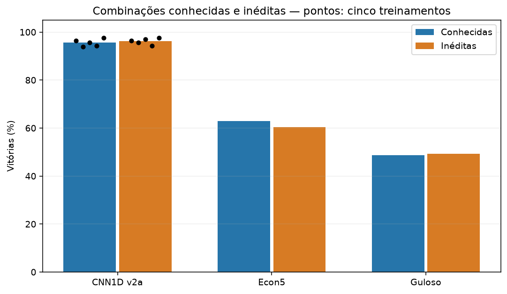
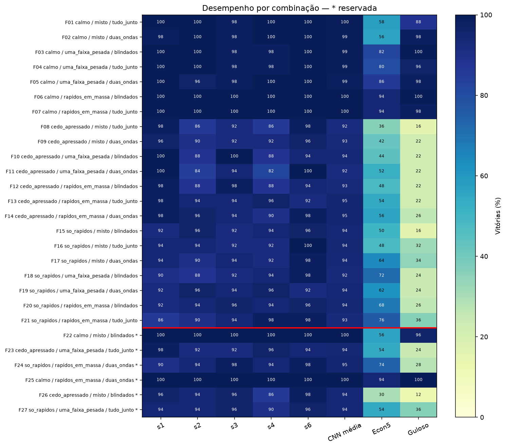
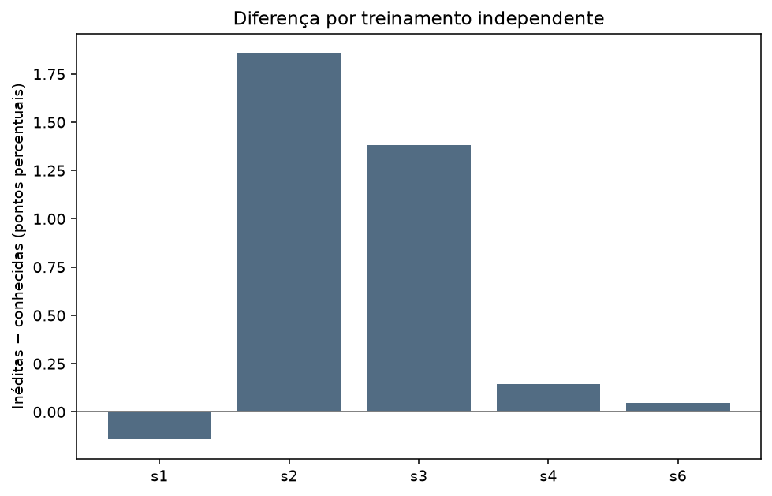

# Avaliação final de generalização — CNN1D PPO v2a

Gerado em 2026-10-27T15:19:14.308742+00:00. Protocolo SHA-256: `d9c844fd434c0ff3616181c00f3d41ef23c72aa5ba1804f04743f71dde7f680a`.

## Objetivo e protocolo

Medir novas realizações de 21 combinações conhecidas e generalização para seis combinações reservadas, sem treinamento ou seleção adicional. Cinco pesos finais das sementes 1, 2, 3, 4 e 6; Econ5 e Guloso. Mesmas sementes 10100–10149 para cada combinação e agente, dificuldade 1,0, k=20, política argmax mascarada, observação v2 e inferência CUDA determinística. Total: 9.450 partidas (6.750 CNN, 2.700 baselines). As sementes numéricas são compartilhadas; o gerador incorpora a combinação. A separação de fases permanece intacta.

Não há critério binário de sucesso ou equivalência. Robustez por aumento de dificuldade não integra este experimento. A reserva é relativa ao desenvolvimento do PPO: baselines e proxy já usaram essas combinações historicamente.

## Preparação e integridade

Os cinco modelos foram carregados estritamente. O pré-teste reproduziu os resultados históricos em 420 partidas conhecidas por modelo, verificou formas e máscara, ausência de gradientes, morte abrupta/retomada exata, idempotência e exclusão mútua. O protocolo foi congelado antes das partidas principais; as 7.350 partidas conhecidas de todos os agentes terminaram antes da abertura das reservadas. Datas e hashes estão em protocolo.json, validacao.json, abertura_teste.json e eventos.jsonl.

Integridade final: {"utc": "2026-10-27T15:19:07.486378+00:00", "partidas": 9450, "sqlite": "ok", "historicos_alterados": [], "hashes_congelados": "ok"}. Erros técnicos registrados na avaliação principal: 0. Interrupções e saídas de processo também constam em eventos.jsonl.

## Modelos

| Agente | SHA-256 dos pesos finais |
|---|---|
| cnn1d-v2a-s1 | `a9767850f73583462d140424bbd2652e5e1fbe71329caff6527ce9daa63616e8` |
| cnn1d-v2a-s2 | `2f8f57f66255bde96b7052bd6bf44078035ba78a790757f15fa02fd958e675b3` |
| cnn1d-v2a-s3 | `67cc68396d79ffdb3d7157876d3878f3494625cf69acb7ade6ae60ebcd7f69d3` |
| cnn1d-v2a-s4 | `b2a82c8ceb1c8d75e18b5b29bfec64ae9ea614df29b0079b245c437ca82aae80` |
| cnn1d-v2a-s6 | `2d7c8267c44aead524a35ed2394b07d8f6f51a7fb79bb2d1e5b131a84115ca27` |

## Resultados por modelo e conjunto

| Agente | Conhecidas | Inéditas | Inéditas − conhecidas (pp) |
|---|---:|---:|---:|
| cnn1d-v2a-s1 | 96.48% | 96.33% | -0.14 |
| cnn1d-v2a-s2 | 93.81% | 95.67% | +1.86 |
| cnn1d-v2a-s3 | 95.62% | 97.00% | +1.38 |
| cnn1d-v2a-s4 | 94.19% | 94.33% | +0.14 |
| cnn1d-v2a-s6 | 97.62% | 97.67% | +0.05 |
| econ5 | 62.95% | 60.33% | -2.62 |
| guloso | 48.67% | 49.33% | +0.67 |

## Configuração CNN1D: cinco réplicas

| Medida | Média | DP entre treinos | IC t 95% |
|---|---:|---:|---:|
| conhecida | 95.54 | 1.58 | [93.58, 97.51] |
| inedita | 96.20 | 1.28 | [94.61, 97.79] |
| inedita_menos_conhecida | 0.66 | 0.90 | [-0.46, 1.77] |

Valores em % ou pontos percentuais para diferenças. IC t com cinco treinamentos é aproximado; condiciona às fases e partidas fixadas e não prova equivalência.

## Comparação com heurísticas

| Conjunto | Diferença CNN − baseline (pp) | Média | DP entre modelos |
|---|---|---:|---:|
| conhecida | cnn1d_menos_econ5 | +32.59 | 1.58 |
| conhecida | cnn1d_menos_guloso | +46.88 | 1.58 |
| inedita | cnn1d_menos_econ5 | +35.87 | 1.28 |
| inedita | cnn1d_menos_guloso | +46.87 | 1.28 |

## Incerteza adicional

| Métrica | IC bootstrap 95% (%, ou pp) |
|---|---:|
| cnn_conhecida | [93.37, 97.37] |
| cnn_inedita | [93.13, 98.87] |
| inedita_menos_conhecida | [-2.65, 3.89] |
| cnn_menos_econ5_conhecida | [25.56, 39.77] |
| cnn_menos_econ5_inedita | [20.33, 51.20] |
| cnn_menos_guloso_conhecida | [32.70, 60.34] |
| cnn_menos_guloso_inedita | [20.53, 71.87] |

Bootstrap hierárquico exploratório com 10.000 reamostragens de modelos, fases e sementes dentro da fase, pareado entre agentes. Trata as fases como população empírica; as seis inéditas são poucas e foram fixadas por desenho, não sorteadas de toda distribuição possível. O IC não autoriza generalização a novos tipos de zumbis, regras ou dificuldades.

Wilson por modelo/conjunto e por fase está nos CSVs. Esses intervalos condicionam às fases escolhidas e pressupõem partidas Bernoulli independentes; heterogeneidade e sorteios compartilhados limitam a leitura. As 6.750 partidas da CNN não são 6.750 réplicas de treinamento.

## Resultados por combinação

| ID | Grupo | Início / meio / fim | CNN média ± DP treinos | Econ5 | Guloso |
|---|---|---|---:|---:|---:|
| F01 | conhecida | calmo / misto / tudo_junto | 99.60 ± 0.89 | 58.00 | 88.00 |
| F02 | conhecida | calmo / misto / duas_ondas | 99.20 ± 1.10 | 56.00 | 98.00 |
| F03 | conhecida | calmo / uma_faixa_pesada / blindados | 99.20 ± 1.10 | 82.00 | 100.00 |
| F04 | conhecida | calmo / uma_faixa_pesada / tudo_junto | 99.20 ± 1.10 | 80.00 | 96.00 |
| F05 | conhecida | calmo / uma_faixa_pesada / duas_ondas | 98.80 ± 1.79 | 86.00 | 98.00 |
| F06 | conhecida | calmo / rapidos_em_massa / blindados | 100.00 ± 0.00 | 94.00 | 100.00 |
| F07 | conhecida | calmo / rapidos_em_massa / tudo_junto | 100.00 ± 0.00 | 94.00 | 98.00 |
| F08 | conhecida | cedo_apressado / misto / tudo_junto | 92.00 ± 6.00 | 36.00 | 16.00 |
| F09 | conhecida | cedo_apressado / misto / duas_ondas | 93.20 ± 2.68 | 42.00 | 22.00 |
| F10 | conhecida | cedo_apressado / uma_faixa_pesada / blindados | 94.00 ± 6.00 | 44.00 | 22.00 |
| F11 | conhecida | cedo_apressado / uma_faixa_pesada / duas_ondas | 92.00 ± 8.60 | 52.00 | 22.00 |
| F12 | conhecida | cedo_apressado / rapidos_em_massa / blindados | 93.20 ± 5.02 | 48.00 | 22.00 |
| F13 | conhecida | cedo_apressado / rapidos_em_massa / tudo_junto | 94.80 ± 2.28 | 54.00 | 22.00 |
| F14 | conhecida | cedo_apressado / rapidos_em_massa / duas_ondas | 95.20 ± 3.35 | 56.00 | 26.00 |
| F15 | conhecida | so_rapidos / misto / blindados | 94.00 ± 2.00 | 50.00 | 16.00 |
| F16 | conhecida | so_rapidos / misto / tudo_junto | 94.40 ± 3.29 | 48.00 | 32.00 |
| F17 | conhecida | so_rapidos / misto / duas_ondas | 93.60 ± 2.97 | 64.00 | 34.00 |
| F18 | conhecida | so_rapidos / uma_faixa_pesada / blindados | 92.40 ± 3.85 | 72.00 | 24.00 |
| F19 | conhecida | so_rapidos / uma_faixa_pesada / duas_ondas | 94.00 ± 2.00 | 62.00 | 24.00 |
| F20 | conhecida | so_rapidos / rapidos_em_massa / blindados | 94.40 ± 1.67 | 68.00 | 26.00 |
| F21 | conhecida | so_rapidos / rapidos_em_massa / tudo_junto | 93.20 ± 5.22 | 76.00 | 36.00 |
| F22 | inédita | calmo / misto / blindados | 100.00 ± 0.00 | 56.00 | 96.00 |
| F23 | inédita | cedo_apressado / uma_faixa_pesada / tudo_junto | 94.40 ± 2.61 | 54.00 | 24.00 |
| F24 | inédita | so_rapidos / rapidos_em_massa / duas_ondas | 94.80 ± 3.35 | 74.00 | 28.00 |
| F25 | inédita | calmo / rapidos_em_massa / duas_ondas | 100.00 ± 0.00 | 94.00 | 100.00 |
| F26 | inédita | cedo_apressado / misto / blindados | 94.00 ± 4.69 | 30.00 | 12.00 |
| F27 | inédita | so_rapidos / uma_faixa_pesada / tudo_junto | 94.00 ± 2.45 | 54.00 | 36.00 |

## Dano, decisões e variação entre fases

| Grupo | Agente | Dano médio | Decisões médias | DP das taxas entre fases (pp) |
|---|---|---:|---:|---:|
| conhecida | CNN1D média | 0.9636 | 166.52 | 2.94 |
| conhecida | Econ5 | 0.7396 | 126.66 | 17.11 |
| conhecida | Guloso | 0.5102 | 93.84 | 35.32 |
| inedita | CNN1D média | 0.9694 | 167.01 | 2.96 |
| inedita | Econ5 | 0.7335 | 127.61 | 21.63 |
| inedita | Guloso | 0.5105 | 94.85 | 38.51 |

Combinações inéditas com menor vitória média: F27 (94.00%); F26 (94.00%); F23 (94.40%).

## Interpretação e limitações

A configuração obtém 96.20% nas inéditas contra 95.54% nas conhecidas: diferença inéditas − conhecidas de +0.66 pp. Os cinco resultados devem ser lidos em conjunto; não foi escolhido o melhor modelo. As diferenças por fase e por treinamento acima delimitam o desempenho observado. Uma média elevada não significa generalização perfeita.

As fases dos dois conjuntos são diferentes; a diferença de taxas mistura a composição dos conjuntos e possível dificuldade de generalização. Os baselines fornecem contexto, não eliminam esse fator e não estabelecem causalidade. A avaliação mede recombinação de segmentos conhecidos, não classes inteiramente novas. A receita foi selecionada em fases conhecidas. Cinco treinamentos e seis fases reservadas limitam precisão e alcance. A inferência determinística foi verificada neste hardware/software; outro backend pode produzir pequenas diferenças numéricas.

## Próximos experimentos possíveis

Qualquer ajuste após esta abertura deve ser declarado posterior ao teste. Possíveis extensões: análise de erros nas partidas registradas, estudo previamente especificado de mudanças de distribuição e novos conjuntos reservados independentes. Nenhuma extensão foi executada aqui.

## Figuras

## Dados, reprodução e continuidade

partidas.csv contém um registro único por agente/fase/semente: grupo, treinamento, caminho/hash do checkpoint, hash do protocolo, k, dificuldade, vitória, dano, decisões, contagens de ações, tempo e UTC. Ações: [esperar, girassol, ervilha, repetidora, batata, mina]. O dano é a soma das recompensas sem o bônus terminal ±1. O tempo por partida inclui espera de inferência compartilhada; não somar esses tempos como tempo de parede do experimento.

A fonte transacional é resultados.sqlite (WAL e synchronous=FULL), com chave primária e erros. Os CSVs derivam dessa base; nunca são usados para retomar. resumo_agente_conjunto.csv, resumo_cnn1d.csv, resumo_por_fase.csv, diferencas_baselines.csv, comparacoes_pareadas.csv e incerteza_bootstrap.csv documentam agregações. O protocolo registra o ambiente e hashes de todos os fontes usados.

Para um futuro visualizador, usar partidas.csv, protocolo.json, os checkpoints originais, segmentos/semente/k/dificuldade e os hashes. O simulador determinístico permite reconstruir uma partida com a mesma política; não foram guardados estados por tick nem implementado front-end. Contagens de ações auxiliam seleção de exemplos sem substituir a sequência de ações.
